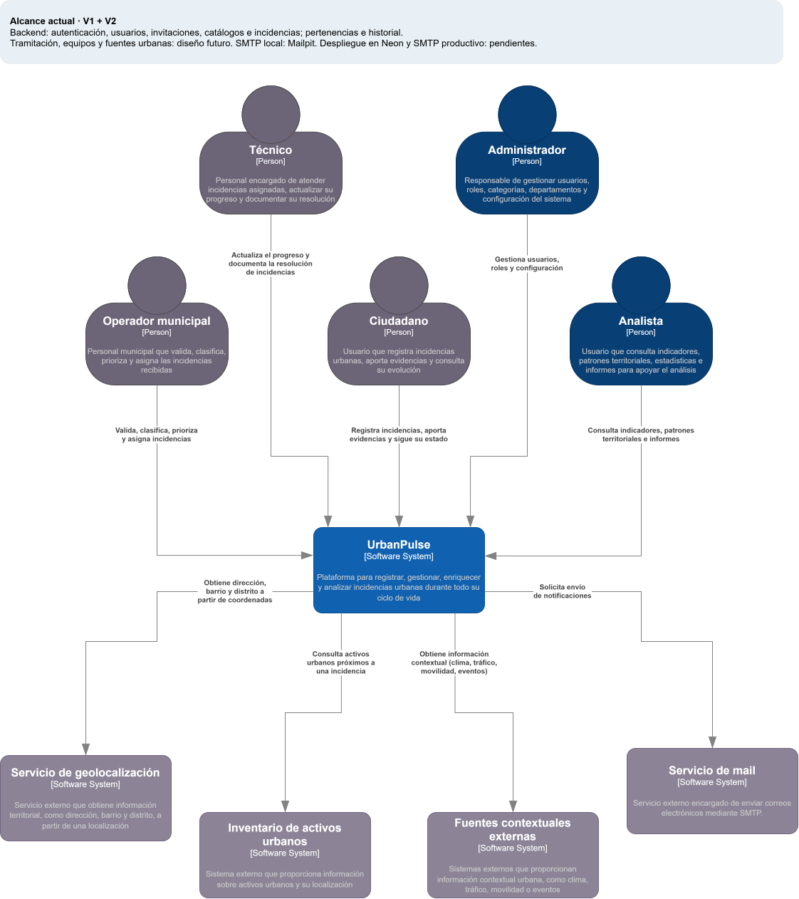
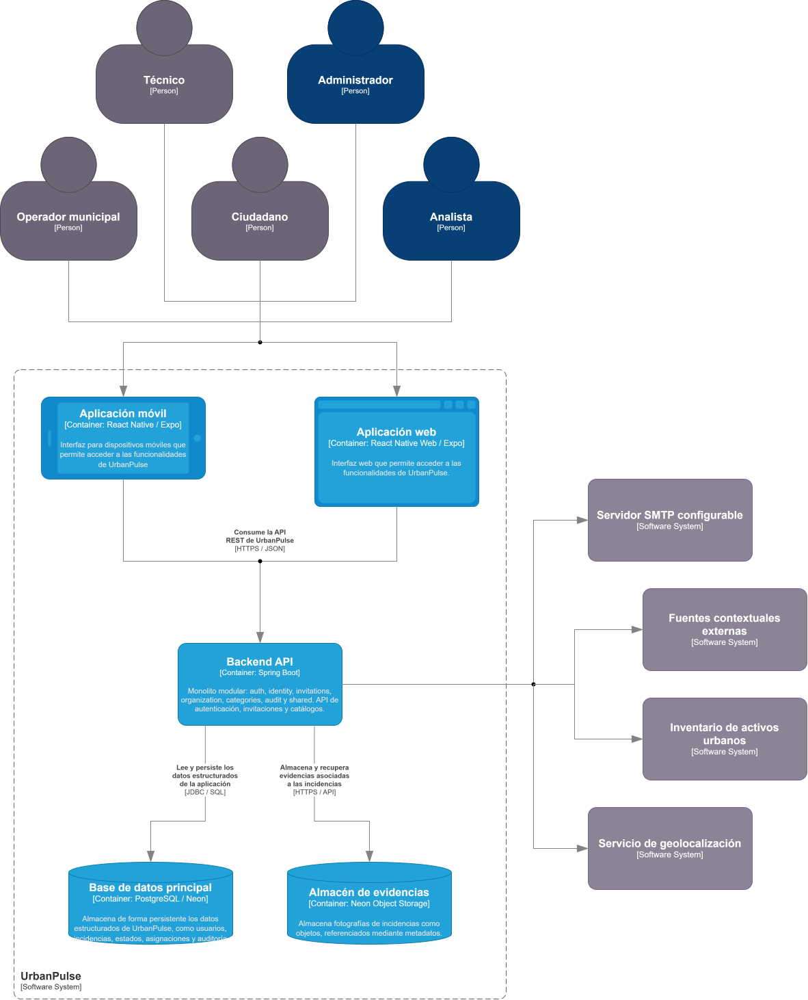

# Arquitectura de UrbanPulse

> **Revisión documental: 03/11/2026.** Autenticación, Department y Category están implementados localmente; la última ejecución documentada del 02/11 superó 109 pruebas con Flyway V1–V3 en PostgreSQL efímero. No consta el despliegue de esas migraciones en Neon. La conectividad con Neon y el arranque conjunto frontend/backend del 15/10 son evidencias anteriores a estas funcionalidades. Incidencias y fotografías siguen pendientes; el modelo completo continúa siendo un diseño revisable. Esta revisión no vuelve a ejecutar las pruebas.

## 1. Alcance y principios

UrbanPulse permitirá reportar incidencias urbanas con ubicación, estado, fotografías e historial; validarlas, priorizarlas y distribuirlas a departamentos y personal municipal; y enriquecerlas progresivamente con activos y observaciones externas. Los catálogos de departamentos y categorías están implementados; la gestión de incidencias sigue pendiente.

Web y móvil compartirán código Expo/React Native y **las mismas autorizaciones del backend**, independientemente de la plataforma. Los impulsores son integridad/trazabilidad, privacidad, seguridad por rol/contexto, mantenibilidad, compatibilidad multiplataforma y minimización de costes universitarios. Se parte de un **monolito por capas**; no se añaden microservicios, colas ni cachés distribuidas sin necesidad comprobada. IA entrenada, analítica predictiva avanzada y RAG opcional continúan aplazados.

## 2. Contenedores lógicos y tecnologías

| Componente           | Tecnología                                                  | Estado                                                                                                |
| -------------------- | ----------------------------------------------------------- | ----------------------------------------------------------------------------------------------------- |
| Aplicación web       | Expo SDK 57, React Native Web, TypeScript, Expo Router      | Pantalla inicial y desarrollo web verificados.                                                        |
| Android/iOS          | Expo / React Native                                         | Código compartido, sin prueba funcional completa en dispositivo.                                      |
| API REST             | Java 25 / Spring Boot 4.1.2 / Maven / Spring Security / JPA | Cinco endpoints de autenticación/verificación y cuatro por catálogo (Department y Category) implementados; incidencias pendientes. |
| Base principal       | Neon PostgreSQL 18                                          | JDBC verificado históricamente en development; Flyway V1–V3 probadas en PostgreSQL 18.6 efímero, sin aplicación acreditada en Neon. |
| Fotografías          | Neon Object Storage compatible con S3                       | Bucket privado y `HeadBucket` comprobados; operaciones de contenido pendientes.                       |
| Proveedores externos | Mapas, geocodificación, inventario, notificaciones          | Selección/integración pendientes.                                                                     |

Los clientes solo se comunican con la API; no reciben credenciales PostgreSQL ni S3. Las claves se suministran mediante configuración segura del backend.

## 3. Arquitectura C4 y modelo de dominio

### 3.1. C4 nivel 1: contexto

### 3.2. C4 nivel 2: contenedores

Las fuentes editables están en [`diagrams/c4.drawio`](diagrams/c4.drawio). Un contenedor C4 es una unidad lógica, no necesariamente un contenedor Docker; los almacenes administrados de Neon pueden estar dentro del límite lógico del sistema. **Pendiente:** C4 de contenedores todavía menciona vídeos/documentos; el alcance inicial acordado es solo fotografías (ADR-0004).

### 3.3. Modelo de dominio lógico

- [Relacional multipágina](diagrams/relacional.drawio): tablas propuestas, PK/FK y relaciones en cuatro páginas (incidencias, tramitación, identidad/organización, territorio/contexto).
- [Catálogo simplificado de clases](diagrams/clases-simplificado.drawio): clases Java candidatas, campos, enum, `@Embeddable` y DTO, sin conexiones UML por diseño. Exportaciones SVG indexadas en [diagramas](diagrams/README.md).
- [Modelo de dominio](domain-model.md) y [contrato dominio–OpenAPI](api/domain-openapi.md) se revisan juntos por tag. El `0.2.0` fue base; el contrato `0.4.0` incluye autenticación, verificación de correo, Department y Category implementados. Los pendientes de sincronización y comprobación visual se mantienen en la [guía de diagramas](diagrams/README.md).
- [Diseño de autenticación](auth-design.md) registra las decisiones ya implementadas y diferencia las mejoras futuras.

Aparecer en un dibujo no convierte una entidad en JPA real ni obliga a migrar su tabla en este tag. El PR del tag debe modificar contrato, diagramas y ADR coherentemente cuando evolucionen los requisitos.

### 3.4. Diagramas todavía pendientes

- C4 Deployment: hosting real, HTTPS, dominio y redes.
- Secuencia de subida autorizada de fotografías y registro de incidencia.
- Máquina de estados detallada y matriz de transiciones/permisos.
- Antes de futuras ampliaciones, contrastar la página ER de identidad y las clases simplificadas con la V1 ejecutada en pruebas, sin añadir tablas de tags pendientes.

## 4. Frontend universal: estructura y estado

`frontend/` incluye Expo Router en `src/app`, `components`, `features`, `services` y `types`; Metro, TypeScript y ESLint. `web.output="single"` genera una SPA exportable; `npx expo export --platform web` se ha verificado, pero no la imagen final Nginx de producción. No existe todavía formulario de incidencias, cliente API integrado, login real ni reglas de permisos visuales. Ninguna restricción visual sustituye la autorización del backend. `EXPO_PUBLIC_API_URL` es pública y no almacena secretos.

## 5. Backend: estructura existente y diseño de autenticación

Clase principal `es.grupo18.urbanpulse.BackendApplication`; subpaquetes `config`, `controller`, `dto`, `entity`, `repository`, `service`. En `config` existen `StorageConfig`/`StorageProperties` y configuración JWT, rate limiting, SMTP y verificación. Se implementaron `controller/AuthController`, DTO, entidades, repositorios, servicios, filtros Spring Security y manejadores de errores; Department y Category siguen la misma arquitectura por capas; los demás módulos siguen pendientes.

Arquitectura aplicada al módulo auth: `Controller → Service → Repository → PostgreSQL`, con DTO independientes de entidades JPA. Puerto 8888 configurable, HikariCP, `spring.jpa.open-in-view=false`, `spring.jpa.hibernate.ddl-auto=validate`, Flyway y configuración externa de storage. El SDK S3 conserva acceso al bucket privado.

**Autenticación implementada:** controlador REST con registro/login/cambio de contraseña/confirmación/reenvío, servicios `AuthService`/`JwtTokenService`/`EmailVerificationService`, Spring Security con JWT firmado, consulta de cuenta activa y roles vigentes por petición y filtro de limitación para login/registro. La persistencia comprende `User`, `Role`, `UserRole`, **`EmailVerification`** y el embebido de preferencias; `emailVerified=false`, `tokenVersion=0` y `CITIZEN` al alta. Existen `Department` con tabla `departments` (V2) y `Category` con tabla `categories` (V3); `StaffInvitation`, equipos y pertenencias departamentales siguen pendientes. [Detalle completo](auth-design.md).

JWT de acceso de **2 horas**, sin refresh; claims `sub`/`iat`/`exp`/`iss`/`ver`. Al cambiar la contraseña se incrementa `tokenVersion` transaccionalmente, invalidando tokens previos en la siguiente petición. BCrypt para credenciales; rate limiting local por instancia y `429`. La verificación de email está implementada con Mailpit local sin proveedor externo real; la recuperación de contraseña queda pendiente. La política de permisos no usa los roles del JWT como fuente de verdad: consulta PostgreSQL, y los servicios aplicarán contexto de dominio cuando corresponda.

**Persistencia:** Flyway gestiona versiones en `backend/src/main/resources/db/migration/`: V1 crea `users`, `roles`, `user_roles` y `email_verifications` y siembra cinco roles; V2 crea departamentos y sus semillas; V3 crea únicamente categorías, sin semillas ni FK a módulos pendientes. Las tres se verificaron juntas en PostgreSQL 18 efímero; **no consta su aplicación en Neon `development` ni `production`**. Hibernate `ddl-auto=validate` no crea tablas. UUIDv7 está configurado en Hibernate y comprobado para `User`, `Department` y `Category`. [Política de migraciones](adr/0006-flyway.md) y [generación de identificadores](adr/0011-identificadores-uuidv7.md).

**Contrato REST:** fuente modular en [`api/openapi/base-openapi.yaml`](api/openapi/base-openapi.yaml). Tras revisar y editar, regenerar `api/openapi.yaml` y `api/openapi.html` mediante Redocly; estos no son fuentes mantenidas a mano. Mantener identificadas las rutas implementadas de auth, departamentos y categorías frente a las rutas meramente diseñadas del resto de tags; regenerar los artefactos derivados tras modificar OpenAPI.

## 6. Dominio operativo previsto

**Categorías implementadas (02/11/2026):** `CategoryController → CategoryService → CategoryRepository`, con DTO separados de creación, actualización y respuesta. PATCH usa `PESSIMISTIC_WRITE` durante la transacción para conservar los campos omitidos tras cambios concurrentes; si dos peticiones cambian el mismo campo prevalece la última escritura serializada, sin protocolo ETag/versionado. `saveAndFlush` permite traducir únicamente SQLSTATE `23505` del índice `uk_categories_name_normalized` a conflicto de nombre; otras violaciones de integridad siguen el manejo global. Los errores específicos extienden `ApiException` y reutilizan `GlobalExceptionHandler` y `ProblemDetailFactory`, sin otro advice. `SecurityConfig` exige EMAIL_VERIFIED para GET y además ADMIN global para POST/PATCH, consultado en PostgreSQL y nunca confiado al JSON o a roles del JWT. [Reglas de dominio](domain-model.md#catálogo-category), [contrato HTTP](api/README.md#contrato-de-categorías) y [pruebas](development.md#73-verificación-documentada-del-backend).

**Auditoría administrativa (RF18) pendiente:** el catálogo no registra actor ni historial de operaciones. Requiere un diseño transversal de `AuditEvent` y su persistencia; añadir fechas internas o utilizar la parte temporal del UUID no satisface ese requisito.

**Seguridad implementada:** JWT HS256 de 7200 s y BCrypt 12; cada petición protegida consulta actividad, versión y roles globales de PostgreSQL y exige el rol `CITIZEN`. El cambio de contraseña invalida JWT anteriores incrementando `tokenVersion` transaccionalmente. Fallo tipado de conexión/timeout PostgreSQL → `503`; JWT inválido → `401`; fallo interno → `500`. Registro y login usan limitadores independientes en memoria; los cinco POST auth limitan el cuerpo a 16 KiB. El acceso requiere `EMAIL_VERIFIED` salvo operaciones de autenticación limitadas para cuentas pendientes; confirmación/reenvío cuentan con buckets independientes. Los permisos departamentales/por titularidad quedan para otros tags.

**Incidencia (`Incident`):** informante, categoría opcional, coordenadas y datos derivados opcionales, fotografías, historia de estados, prioridad justificada y departamento responsable opcional. Falta de proveedores externos no bloquea creación.

**Roles y ámbito (ADR-0009):** `User` común, `Role` persistente, roles globales `CITIZEN`, `OPERATOR`, `ADMIN` mediante `UserRole`, departamentales `DEPARTMENT_COORDINATOR`, `TECHNICIAN` mediante `DepartmentMembership`. Toda cuenta tiene `CITIZEN`; roles municipales se acumulan. `OPERATOR` no necesita departamento; coordinador/técnico actúan por pertenencias activas. Equipos estables conservan miembros históricos.

**Tramitación (ADR-0010):** estados `REPORTED`, `VALIDATED`, `REJECTED`, `ASSIGNED_TO_DEPARTMENT`, `WORK_ASSIGNED`, `IN_PROGRESS`, `RESOLVED`, `REOPENED`, `CLOSED`. Puede validarse sin departamento. La derivación cambia `Incident.assignedDepartment`; una `Assignment` solo aparece para trabajo a equipo/técnico, con historial y como máximo una activa. `StatusChange` audita transiciones y `AuditEvent` decisiones/traslados sin cambio de estado. Matriz exhaustiva pendiente.

**Prioridades:** LOW, MEDIUM, HIGH, CRITICAL; `PriorityDecision` auditable. **Duplicados:** sugerencias calculadas, confirmación humana de `DuplicateLink`, sin rechazo o vinculación automática; IA semántica futura.

**Identidad/seguridad:** registro público ciudadano, invitaciones de personal aceptadas como mecanismo pero sin implementar, canje sobre cuenta existente sin duplicar usuario, roles/ámbito/titularidad comprobados por backend. Invitaciones globales solo OPERATOR/ADMIN, con CITIZEN base. Primer ADMIN administrado manualmente en una tarea futura.

**Identificadores:** UUIDv7 en entidades persistentes, con excepciones natural/compuesta, generación desde Hibernate probada con PostgreSQL aislado para User, Department y Category.

**Contexto urbano:** `UrbanAsset`, `UrbanAssetAssociation`, `ExternalSource`, `ExternalObservation` son esqueleto provisional; `UrbanContextViewDTO` es vista, sin tabla. No elegir proveedores/PostGIS por anticipado.

## 7. Seguridad, almacenamiento y resiliencia

- Spring Security y los servicios controlan roles y contexto, no solo x-roles de OpenAPI.
- JWT: decisiones de duración, claims, autorización actual y versión de revocación documentadas en ADR-0005. Permanecen pendientes la rotación de claves en despliegue, distribución segura de tokens al cliente y verificación por correo ya implementada localmente.
- Evidencias: bucket privado `incident-evidence`; metadata PostgreSQL, binarios externos. Autorización por fotografía, formato/tamaño, EXIF, retención y limpieza de huérfanos pendientes.
- Fallos de contexto urbano: degradar sin impedir el registro; no suponer proveedores existentes porque aparezcan en diagramas.
- Secretos fuera de Git; HTTPS, configuración de CORS, políticas de transporte JWT y tratamiento de CSRF antes de despliegue.
- Errores HTTP comunes sin SQL, causas internas, credenciales ni tokens; se conserva desactivado el logger de errores SQL de Hibernate para evitar exponer detalles de persistencia.
- Rate limiting: inicialmente en memoria por instancia, no distribuido; requiere memoria limitada, reposición temporal y control de IP confiable detrás de proxy.

## 8. Verificaciones técnicas comprobadas y próximas etapas

- Frontend (13/10/2026): `expo install --check`, Expo Doctor 21/21, `tsc`, ESLint, exportación web y Compose de desarrollo comprobados.
- Docker Compose conjunto (15/10/2026): frontend y backend arrancaron correctamente.
- Neon `development` (15/10/2026): prueba manual `docker compose run --rm backend mvn -B -Dtest=NeonConnectivityIT test` con JDBC y `HeadBucket`; no valida pertenencia a rama por sí misma ni operaciones completas de fotos.
- **Autenticación (28/10/2026, histórico):** 55 pruebas superadas (35 unitarias/MVC y 20 de integración), anteriores a los catálogos.
- **Última ejecución documentada (02/11/2026):** 109 pruebas superadas (78 unitarias/MVC y 31 PostgreSQL), sin fallos, errores ni omisiones; incluye autenticación, correo, Department, Category y Flyway V1–V3 en PostgreSQL efímero. [Comando, desglose y cobertura](development.md#73-verificación-documentada-del-backend). No se repite en esta revisión documental del 03/11.

**Pendiente:** integración backend real+Mailpit, aplicación controlada de V1–V3 en Neon `development`, integración de categorías con incidencias, auditoría RF18, [comprobación visual completa tras Category](diagrams/README.md#revisión-category-02112026), Android/iOS en dispositivo, frontend Nginx de producción, CI/CD y despliegue real. La verificación aislada no acredita ninguno de esos pasos.

**Siguiente trabajo:** comprobar el funcionamiento real backend+Mailpit, preparar el despliegue controlado en Neon `development` cuando corresponda y seguir con los demás tags tras acordar modelo, contrato y permisos; no crear anticipadamente todas las entidades.

## 9. Referencias

- [Diseño de autenticación](auth-design.md).
- [Modelo de dominio](domain-model.md) y [diagramas](diagrams/README.md).
- [ADR](adr/README.md), [API](api/README.md), [desarrollo](development.md), [despliegue](deployment.md).

### Correo transaccional y limpieza

La arquitectura añade `EmailSender`/`SmtpEmailSender` con Spring Mail; un evento `AFTER_COMMIT` envía el código fuera de la transacción. `compose.yaml` incorpora Mailpit como servidor SMTP de desarrollo (sin envíos externos), con interfaz local de consulta. La tabla `email_verifications` almacena el HMAC y caducidad; un servicio programado en el backend limpia códigos vencidos y usuarios sin verificar de más de 24 horas en lotes con bloqueo compatible con confirmación/reenvío. La entrega no tiene outbox ni reintentos automáticos: existe reenvío manual. Revisar la eliminación de cuentas al añadir nuevas entidades dependientes. [Detalle](auth-design.md).

## Departamentos municipales — revisión 30/10/2026

La revisión de 30/10/2026 implementó `Department`: GET listado/detalle en `/api/v1/departments`, POST y PATCH. GET exige identidad y correo verificado; escritura añade rol global ADMIN, consultado en PostgreSQL por la seguridad existente. Desactivar mediante `active=false` conserva el registro y su UUID; no existe DELETE.

Nombre (2–120) y código ASCII (2–20) se recortan con `trim()` antes de validar; se conservan espacios interiores del nombre y se convierte el código a mayúsculas. Unicidad sin distinguir mayúsculas. Descripción opcional hasta 500; alta activa por defecto. PATCH omite para conservar, rechaza null explícito (400), permite descripción vacía y exige algún campo (422). El listado incluye activos/inactivos ordenados por nombre según la collation de PostgreSQL. Los parches concurrentes bloquean la fila durante la transacción.

`Department` usa UUIDv7 Hibernate según ADR-0011. V2 crea `departments`, índices únicos y semillas fijas; se conserva V2 sin modificar su checksum. El default SQL uuidv7() cubre inserciones externas. Las fechas son internas, `createdAt` inmutable y `updatedAt` cambia al modificar datos. No se crean FK hacia módulos todavía no implementados.

Errores comunes ProblemDetail con `code`, `title`, `status`, `detail`, `instance`: 400 entrada no interpretable/UUID inválido, 401 JWT, 403 permisos/verificación, 404 DEPARTMENT_NOT_FOUND, 409 DEPARTMENT_DUPLICATE, 422 validación, 500 fallo interno y 503 indisponibilidad tipada. Solo SQLSTATE 23505 de los dos índices conocidos se traduce a duplicado. Consulte [informe de cierre](departments-finalization.md) para resultados y limitaciones.
