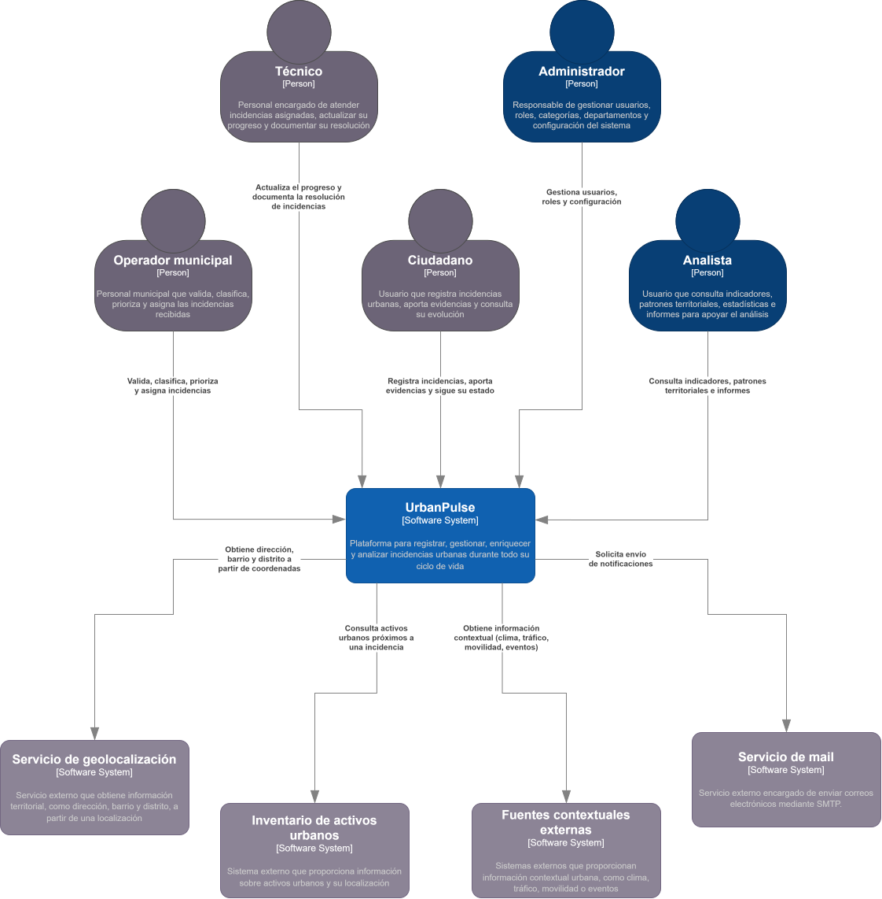
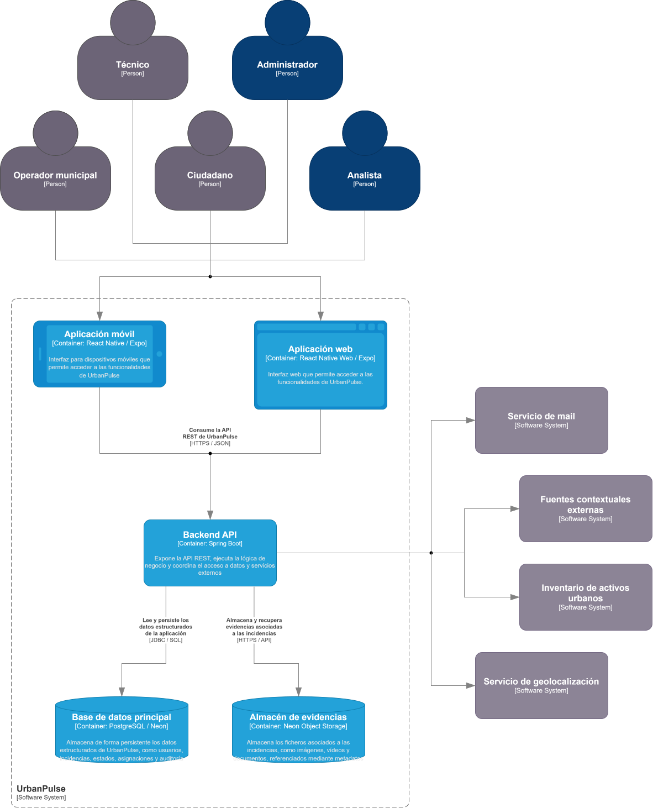

# Arquitectura de UrbanPulse

> **Estado (15/10/2026):** frontend web y arranque conjunto frontend/backend con Docker Compose comprobados; Neon PostgreSQL y Object Storage aprovisionados y accesibles desde Spring Boot en `development`. **No existen aún endpoints de negocio, esquema relacional del dominio, flujo de fotografías ni despliegue de producción**. Las decisiones se registran en los [ADR](adr/README.md).

## 1. Alcance y principios

UrbanPulse gestionará incidencias urbanas reportadas por ciudadanos, con ubicación, estados, historial, asignaciones y fotografías. El personal municipal podrá validarlas y gestionarlas, y se incorporarán fuentes contextuales para apoyar la priorización y el análisis. **La funcionalidad de negocio sigue pendiente de implementación.**

La web y las aplicaciones móviles compartirán una base de código y admitirán las mismas funciones según el rol; el uso preferente de móvil por ciudadanos y web por operarios no limitará sus permisos.

Impulsores: integridad y trazabilidad, controles de acceso, mantenibilidad, compatibilidad web/móvil, evolución cloud y minimización de costes para un proyecto universitario. Se comienza con un backend monolítico por capas; no se introducen microservicios ni colas sin una necesidad justificada.

## 2. Contenedores lógicos y tecnologías

| Elemento                 | Tecnología                                                  | Estado                                                         |
| ------------------------ | ----------------------------------------------------------- | -------------------------------------------------------------- |
| Aplicación web           | Expo SDK 57 / React Native Web / TypeScript / Expo Router   | **Pantalla inicial y desarrollo web comprobados**              |
| Aplicaciones Android/iOS | Expo / React Native                                         | Código compartido; **sin prueba funcional en dispositivo**     |
| API REST                 | Java 25 / Spring Boot 4.1.1 / Maven / Spring Security / JPA | Estructura y dependencias; **sin endpoints implementados**     |
| Base de datos            | PostgreSQL administrado por Neon                            | Neon PostgreSQL 18; JDBC probado; esquema de negocio pendiente |
| Almacén de evidencias    | Neon Object Storage (S3)                                    | Bucket privado aprovisionado y cliente S3 comprobado           |
| Sistemas externos        | Mapas, geocodificación, activos urbanos y notificaciones    | Proveedores definitivos pendientes                             |

Las aplicaciones web y móvil consumirán únicamente la API REST del backend. Ni las credenciales de PostgreSQL ni las del almacenamiento de objetos deberán estar presentes en el frontend.

## 3. Diagramas C4

### 3.1. Contexto (nivel 1)



### 3.2. Contenedores (nivel 2)



El contenedor C4 es una **unidad lógica o ejecutable**, no necesariamente un contenedor Docker. PostgreSQL y evidencias pueden aparecer dentro del límite lógico de UrbanPulse aunque sus servicios estén administrados en Neon.

Los SVG actuales son editables desde diagrams.net porque contienen información de draw.io embebida; aún no se dispone de archivos `.drawio` separados en el repositorio.

**Revisión pendiente del C4 de contenedores:** la descripción del almacén de evidencias todavía menciona vídeos y documentos; la primera fase se limita a fotografías. El ADR-0004 ya está aceptado; el dibujo se actualizará al detallar el flujo de evidencias.

### 3.3. Diagramas pendientes

- C4 Deployment: cuando se elijan proveedores de hosting, redes, HTTPS y dominios.
- Modelo entidad-relación: cuando se diseñe PostgreSQL.
- Diagrama dinámico/secuencia: subida autorizada de fotografías y registro de incidencias.
- Ciclo de vida de incidencia y transiciones auditadas.
- Diagramas de diseño detallado (clases/componentes), si aportan valor frente al propio código.

Consulta [diagramas](diagrams/README.md).

## 4. Frontend universal: estructura existente

`frontend/` contiene un proyecto Expo con React Native, React Native Web, React y TypeScript. Utiliza **Metro** para empaquetar y **Expo Router** para navegación basada en archivos. No utiliza Vite ni necesita un frontend web separado.

```text
frontend/
├── assets/                       # Iconos y recursos gráficos provisionales
├── src/
│   ├── app/
│   │   ├── _layout.tsx           # Stack raíz de Expo Router
│   │   └── index.tsx             # Pantalla inicial, probada en web
│   ├── components/               # Futuros componentes reutilizables
│   ├── config/                   # Configuración del cliente
│   ├── constants/                # Constantes / tema futuro
│   ├── features/                 # Funcionalidades agrupadas por dominio
│   ├── services/                 # Cliente HTTP hacia Spring Boot
│   └── types/                    # Tipos TypeScript compartidos
├── app.json                      # Expo: nombre, rutas, web SPA y recursos
├── package.json                  # Dependencias y scripts npm
├── package-lock.json             # Lockfile local utilizado por npm ci / Docker
├── tsconfig.json                 # TypeScript estricto; alias @/
├── eslint.config.js              # ESLint con configuración Expo
├── Dockerfile.dev                # Metro para desarrollo web
├── Dockerfile                    # Exportación web + Nginx en dos etapas
└── nginx.conf                    # Servidor web y fallback de rutas SPA
```

Expo SDK 57 utiliza las versiones declaradas en `package.json` (React 19.2.3, React Native 0.86.3, TypeScript 6.0.3). `expo install --check` y `expo-doctor` se ejecutaron satisfactoriamente. La salida web seleccionada en `app.json` es `web.output="single"` (SPA): el frontend web puede servirse mediante Nginx sin un servidor de renderizado de Expo en producción.

En `src/app/` irán las rutas y layouts, mientras los componentes y la lógica reutilizable estarán fuera de esa carpeta. Las carpetas de dominio todavía están vacías intencionadamente. No se implementan consumo de API, formularios, control de sesión ni permisos visuales.

## 5. Backend: estructura existente

La aplicación principal está en `es.grupo18.urbanpulse.BackendApplication`, anotada con `@SpringBootApplication`. Los subpaquetes iniciales son `config`, `controller`, `dto`, `entity`, `repository` y `service`. `config` ya contiene `StorageConfig` y `StorageProperties`; las capas de negocio siguen vacías y representan una **organización por capas**.

Flujo objetivo: `Controller -> Service -> Repository -> PostgreSQL`, usando DTO para entrada/salida y entidades JPA para persistencia. Las integraciones externas se encapsularán y las reglas de autorización se aplicarán en Spring Security y en los casos de uso pertinentes.

`backend/src/main/resources/application.properties` contiene puerto 8888, propiedades JDBC por variables de entorno, HikariCP, `spring.jpa.hibernate.ddl-auto=validate`, `open-in-view=false`, Flyway y `spring.sql.init.mode=never`. No existe perfil `dev` específico, por decisión actual del equipo.

**Migraciones:** se reserva `backend/src/main/resources/db/migration/`.

El backend **arranca en Docker Compose** con Neon `development` y la prueba `NeonConnectivityIT` verifica JDBC (`SELECT current_database(), current_user`) y acceso S3 (`HeadBucket`). Las URL de entorno determinan la rama Neon utilizada; la prueba no comprueba el ID de rama de forma independiente. El `pom.xml` incorpora AWS SDK for Java 2.x 2.56.0 con BOM y procesador de metadatos `@ConfigurationProperties`; `StorageProperties` valida los datos del bucket. Aún no existen controladores de negocio, entidades JPA, repositorios funcionales ni pruebas de subida/descarga.

## 6. Dominio y estados previstos

La entidad central será `Incident`. El alcance inicial considera usuarios, evidencias, asignaciones, historial de estados, activos urbanos y datos contextuales, sujeto a refinamiento. Los estados previstos incluyen `REPORTED`, `VALIDATED`, `REJECTED`, `ASSIGNED`, `IN_PROGRESS`, `RESOLVED`, `REOPENED` y `CLOSED`; las transiciones válidas y las reglas de auditoría deberán especificarse antes de implementar.

## 7. Seguridad y autorización objetivo

- Registro ordinario de ciudadanos; altas de personal controladas mediante invitaciones (ADR-0007, **propuesto**).
- JWT firmados con validación de Spring Security; su emisión, rotación, revocación y almacenamiento aún no están implementados.
- Autorización por rol, propiedad y estado cuando corresponda; el frontend no sustituye las comprobaciones de seguridad del backend.
- Claves y contraseñas fuera de Git; `EXPO_PUBLIC_*` solo para configuración **pública** integrada en el cliente.
- Futura política de CORS para los orígenes web realmente desplegados.

El almacenamiento de evidencias utiliza un bucket privado `incident-evidence`. Aunque los datos de una incidencia sean visibles, no deben publicarse automáticamente fotografías con información personal. El backend deberá autorizar su acceso, validar formato y tamaño y definir revisión/anonimización y tratamiento EXIF.

## 8. Persistencia y resiliencia

Neon PostgreSQL **18** es el proveedor elegido y ya aprovisionado en AWS Frankfurt. El proyecto `urban-pulse-app` contiene una base `urban-pulse` en las ramas Neon `production` (predeterminada) y `development` (desarrollo). Los roles PostgreSQL `owner` y `backend` separan administración y acceso de aplicación. La protección automática de `production` no está disponible en el plan gratuito actual. Neon Object Storage dispone del bucket privado `incident-evidence` en ambas ramas; las credenciales S3 son distintas por entorno.

Neon PostgreSQL es el proveedor elegido. Flyway es responsable de **crear/evolucionar el esquema**; Hibernate con `ddl-auto=validate` solo verifica la compatibilidad. JPA/Hibernate se usará para operaciones habituales. El pool Hikari está inicialmente limitado a cinco conexiones máximas por instancia, con mínimo inactivo cero, para reducir consumo inactivo; el arranque y una consulta JDBC real ya se han comprobado con Neon. En `development` existe la tabla técnica `flyway_schema_history`, **sin migraciones de dominio**; `production` permanece sin tablas de negocio. Debe evitarse introducir migraciones experimentales en producción.

Se mantendrán metadatos y referencias de fotografías en PostgreSQL y binarios en Object Storage cuando se implemente la funcionalidad. La coordinación de ambos almacenes requerirá gestionar inconsistencias y objetos huérfanos. Un fallo de enriquecimiento contextual no debería impedir registrar una incidencia, salvo que una regla explícita indique lo contrario.

## 9. Entornos, pruebas y evolución

- **Desarrollo web validado:** `npx expo start --web --port 7777`; `docker compose up --build frontend`; ambos en `http://localhost:7777`.
- **Exportación web validada:** `npx expo export --platform web`, que genera `dist/`.
- **Análisis estático validado:** `npx expo install --check`, Expo Doctor (21/21), `npx tsc --noEmit` y `npm run lint`.
- **Integración validada en desarrollo (15/10/2026):** `docker compose up --build` inicia frontend y backend; `docker compose run --rm backend mvn -B -Dtest=NeonConnectivityIT test` supera JDBC y `HeadBucket` privado. El test `*IT` es manual y no se ejecuta en los tests Surefire por defecto.
- **Aún no validados:** Nginx/imagen final de producción, pruebas E2E, pruebas nativas sobre dispositivos, funcionalidad real de la API, operaciones completas de fotografías y despliegue cloud.
- **Arquitectura de producción prevista:** contenedor web Nginx independiente, contenedor Java independiente y apps nativas distribuidas fuera de Docker; proveedor de hosting y dominios pendientes.

El repositorio ya es **público**. La ausencia actual de `LICENSE` se documenta en el README; el grupo aún no ha elegido licencia.

## 10. ADR y referencias

- [ADR y decisiones](adr/README.md)
- [Guía de desarrollo](development.md)
- [Despliegue](deployment.md)
- [Documentación de la API](api/README.md)
- [Diagramas](diagrams/README.md)

La selección dinámica de campos con `fields` no está aprobada y no forma parte del contrato API actual.
