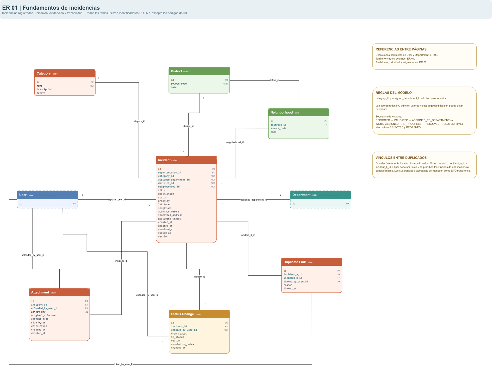
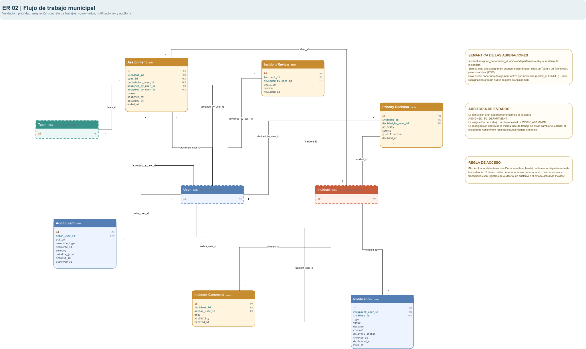
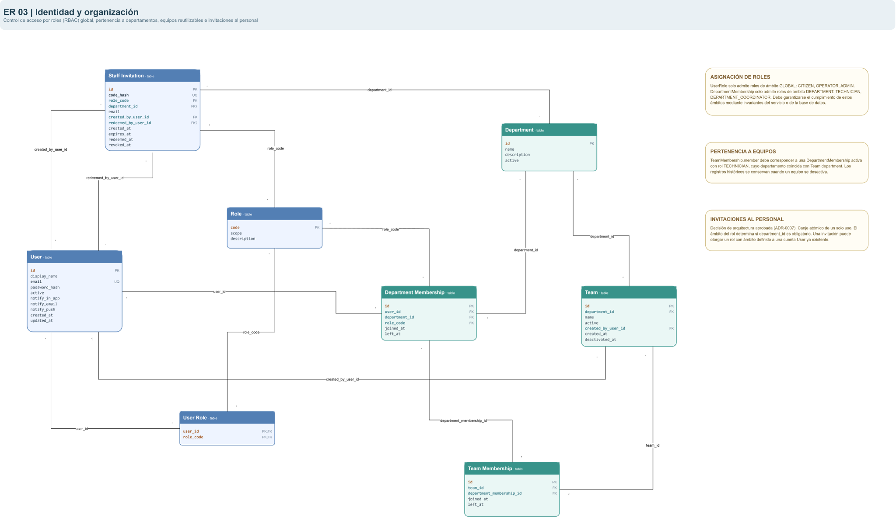
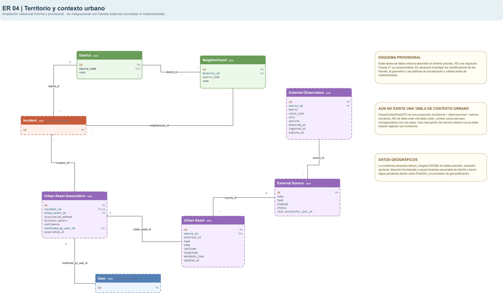

# Diagramas de UrbanPulse

Este directorio contiene las **fuentes editables en diagrams.net / draw.io** y sus exportaciones para revisión en GitHub. Se distinguen los diagramas de arquitectura C4 del **modelo de dominio v1**, que es una base compartida sincronizada con OpenAPI `0.2.0`, todavía pendiente de validación exhaustiva e implementación por tag, **salvo el núcleo de identidad/auth y Department ya implementados**.

## Inventario

| Fuente editable                                            | Exportación para lectura                                                                                                                                                  | Propósito y estado                                                                                                                                                                                                                 |
| ---------------------------------------------------------- | ------------------------------------------------------------------------------------------------------------------------------------------------------------------------- | ---------------------------------------------------------------------------------------------------------------------------------------------------------------------------------------------------------------------------------- |
| [`c4.drawio`](c4.drawio)                                   | [`c4-context.svg`](c4-context.svg) · [`c4-containers.svg`](c4-containers.svg)                                                                                             | Arquitectura C4, contexto y contenedores; diagramas ya disponibles. Se incorpora ahora la fuente `.drawio` independiente.                                                                                                          |
| [`relacional.drawio`](relacional.drawio)                   | [`relacional-01.svg`](relacional-01.svg) · [`relacional-02.svg`](relacional-02.svg) · [`relacional-03.svg`](relacional-03.svg) · [`relacional-04.svg`](relacional-04.svg) | **Modelo relacional lógico v1** en cuatro páginas: incidencias, tramitación, organización, territorio/contexto. El núcleo identidad (`users`, `roles`, `user_roles`, `email_verifications`) ya tiene la migración V1 ampliada; `departments` está implementada mediante V2; las demás tablas siguen propuestas. |
| [`clases-simplificado.drawio`](clases-simplificado.drawio) | [`clases-simplificado.svg`](clases-simplificado.svg)                                                                                                                      | **Catálogo de clases Java (núcleo auth y Department implementados) v1**, una sola página: atributos, tipos, enums, embeddables y DTO auxiliares. Sin líneas UML intencionadamente: consultar relaciones en el ER.                   |

> **Nota de nombres:** las cuatro exportaciones `relacional-01` a `relacional-04` se enlazan aquí como `.svg`, siguiendo el patrón de las demás exportaciones. Si en la copia local se exportaron en `.png`, hay que adaptar los enlaces a las **extensiones reales** antes del commit. La fuente y sus SVG deben quedar sincronizados en cada PR del tag.

## Vistas previas del modelo de dominio

### Relacional: página 1 — Incidencias

### Relacional: página 2 — Tramitación

### Relacional: página 3 — Identidad y organización

### Relacional: página 4 — Territorio y contexto

### Clases Java simplificadas

## Cómo revisar y mantener los modelos

1. Abrir el `.drawio` correspondiente y cambiar de página (el relacional tiene cuatro; el simplificado de clases tiene una).
2. Revisar primero [**el proceso de validación incremental**](../domain-model.md) y el [contrato dominio–API unificado](../api/domain-openapi.md). **No implementar todas las clases por el mero hecho de estar dibujadas**.
3. Al desarrollar un tag, contrastar en conjunto requisitos del enunciado, contratos OpenAPI, relaciones/PK/FK del ER, atributos/tipos de las clases y decisiones ADR.
4. Actualizar **las dos vistas** si cambia una entidad compartida, incluso aunque en el UML simplificado no aparezcan líneas de relación; exportar otra vez las imágenes editadas.
5. Documentar en el PR qué parte del dominio se revisó y qué puntos siguen pendientes. Las imágenes no sustituyen al `.drawio` fuente; conservar ambos.

**Fuera del tag auth:** validación de tipos/capacidades de los proveedores del contexto urbano, diagramas de despliegue de producción o secuencia completa de fotografías. **Dentro de auth ya existen la V1 y entidades JPA mínimas**, aunque no se dibujan los componentes técnicos (filtros, repositorios, DTO HTTP) en el catálogo de dominio. Siguen siendo potencialmente útiles `incident-lifecycle.drawio` y `incident-flow.drawio`, pero están pendientes/no incluidos: no se pretende que existan.

**Revisión C4 pendiente de esta tarea:** `c4-containers.svg` sigue mencionando vídeos/documentos en la descripción de evidencias; el alcance inicial decidido es **solo fotografías** (ADR-0004, aceptado). No se han redibujado diagramas C4 en este PR.

### Cambios visuales pendientes por el sistema de correo (28/10/2026)

Los diagramas de esta carpeta **todavía no se han redibujado** para la nueva entidad y el servicio SMTP. Cambios obligatorios antes de dar por sincronizada la documentación gráfica:

1. En `relacional.drawio`, página **ER 03 (identidad/organización)**, añadir `email_verifications` con `user_id UUID` como PK/FK a `users(id)`, `code_hash BYTEA(32)`, `created_at TIMESTAMPTZ` y `expires_at TIMESTAMPTZ`, relación **User 1 : EmailVerification 0..1**, restricción de hash/caducidad e índices de expiración y usuarios sin verificar. Actualizar `relacional-03.svg`.
2. En `clases-simplificado.drawio`, añadir `EmailVerification` y relación `@MapsId` con `User` en los detalles del catálogo JPA, y la nueva capa de servicio si se representan componentes técnicos. Actualizar `clases-simplificado.svg`.
3. En `c4.drawio`, página de **contenedores**, incorporar la dependencia del backend respecto de un servidor SMTP configurable y **Mailpit solo para desarrollo**; no representarlo como servicio de producción ni insinuar un proveedor real contratado. Actualizar `c4-containers.svg`.

Las fuentes `.drawio` son editables; **no sustituirlas solo modificando el texto de un SVG**. Se conservan sin cambios en este paquete para evitar desincronizar una fuente no regenerada con su exportación. El resto de las entidades de otros tags permanece en estado de diseño.

## Revisión Department (30/10/2026)

Se actualizan únicamente las celdas Department de las dos fuentes: UUIDv7, nombre y código únicos normalizados, descripción opcional, activo y fechas. Las relaciones con equipos, pertenencias e incidencias siguen representando el diseño futuro; no son nuevas FK ni módulos implementados.

`export-department.ps1` regenera el fragmento Department de los dos SVG a partir del texto de las fuentes, conservando las coordenadas y los demás elementos. Se usa texto vectorial para evitar conservar la imagen alternativa antigua de esa celda. Para regenerar: `powershell -File docs/diagrams/export-department.ps1`. Una exportación completa posterior desde diagrams.net puede sustituir estos fragmentos.

Se verificó el XML de las fuentes y se renderizaron localmente los SVG; las dos celdas Department se inspeccionaron como PNG sin recortes de texto ni solapamientos. La apertura interactiva en diagrams.net quedó bloqueada por la herramienta de control del navegador (no pudo verificar la URL activa). No se afirma haber completado esa comprobación manual exigida por CONTRIBUTING. Los pendientes del correo/C4 enumerados arriba son previos y ajenos al módulo Department.
