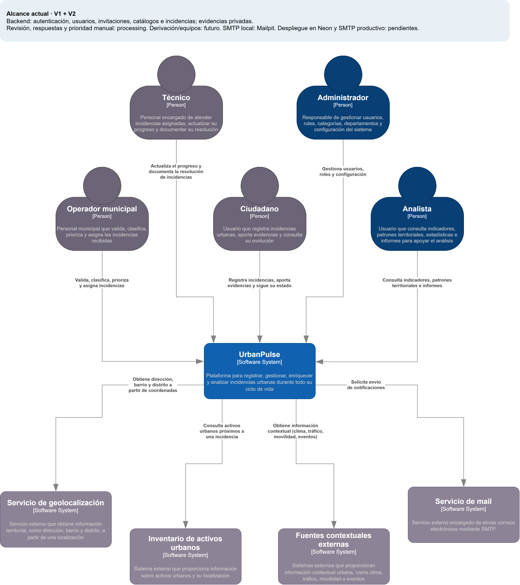
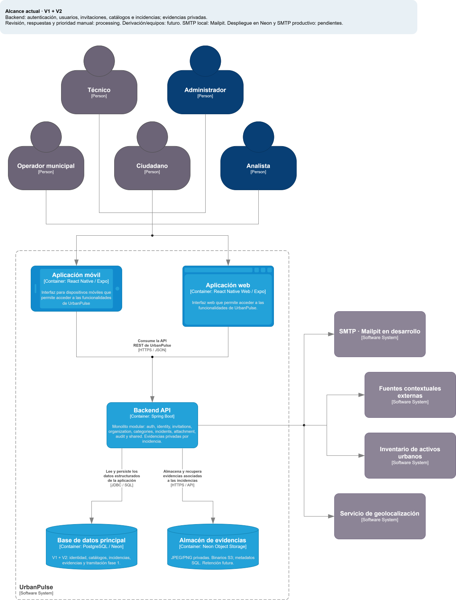
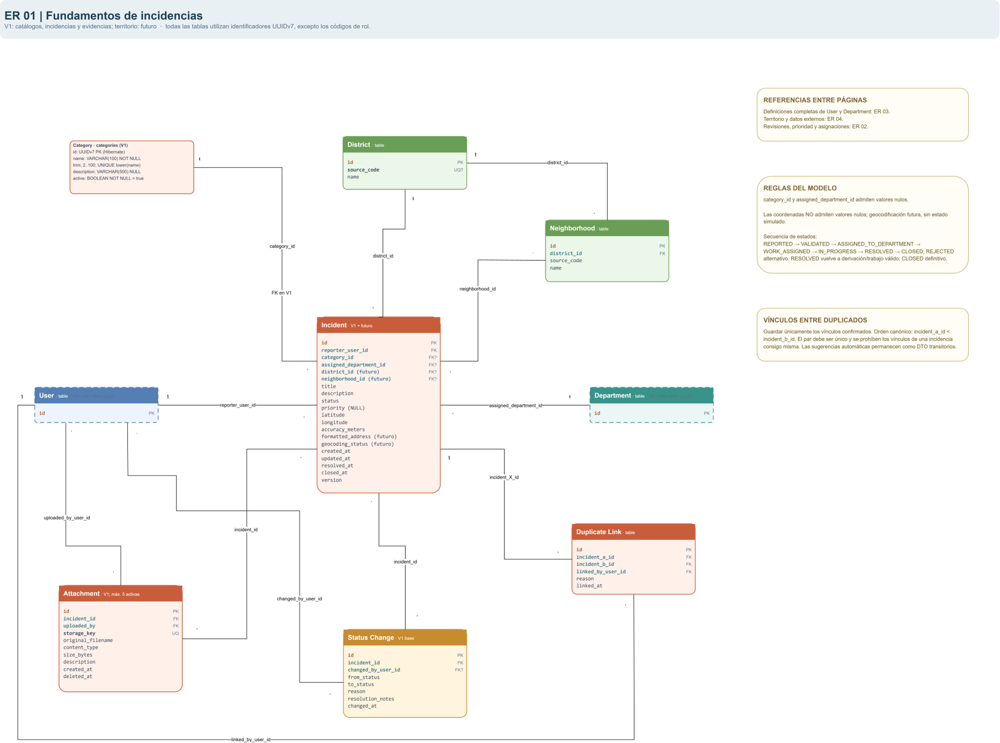
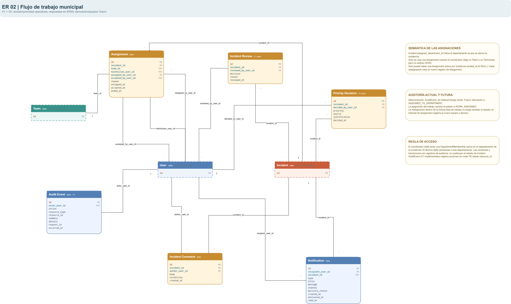
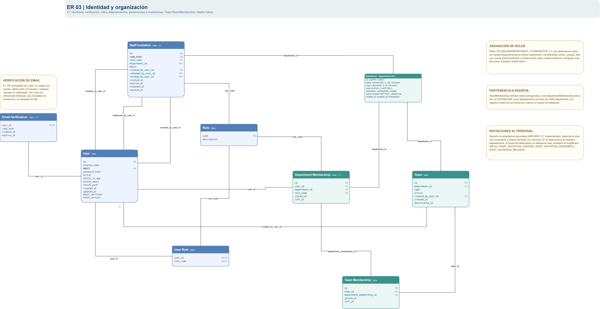
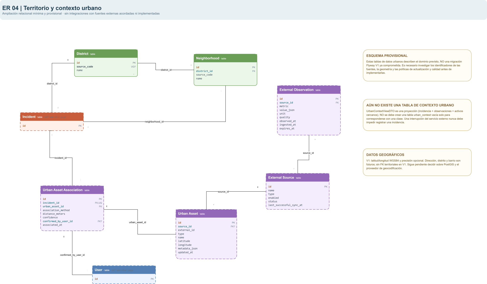
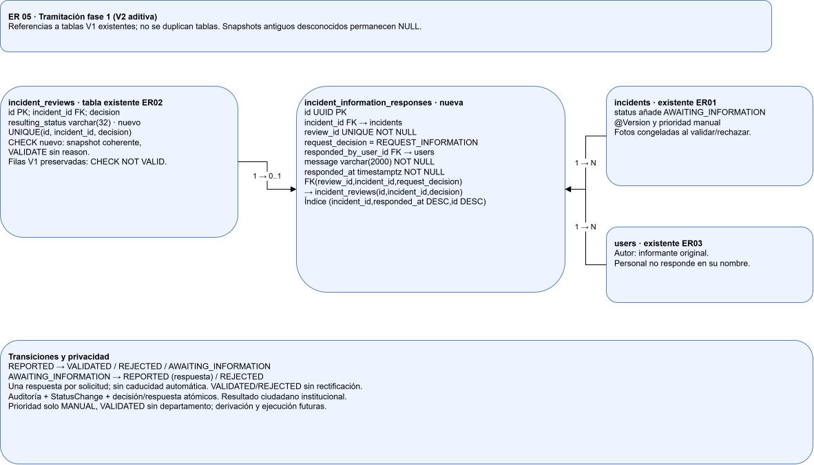

# Diagramas de UrbanPulse

Las tres fuentes editables distinguen el esquema implementado del dominio objetivo. Las ocho exportaciones SVG son históricas. Su correspondencia visual se sigue en [O04](../pending.md#o04).

## Inventario verificable

| Fuente editable                                            | Exportación                                                                                 | Contenido                                                                                                                                                                                                                                 |
| ---------------------------------------------------------- | ------------------------------------------------------------------------------------------- | ----------------------------------------------------------------------------------------------------------------------------------------------------------------------------------------------------------------------------------------- |
| [`c4.drawio`](c4.drawio)                                   | [`c4-context.svg`](images/c4-context.svg) y [`c4-containers.svg`](images/c4-containers.svg) | C4 de contexto y de contenedores; contenedor API, almacenamiento y correo SMTP/Mailpit; alcance inicial de evidencias: fotografías.                                                                                                       |
| [`relacional.drawio`](relacional.drawio), **página 1**     | [`relacional-01.svg`](images/relacional-01.svg)                                             | Category en V1; Incident, Attachment y StatusChange base en V1; DuplicateLink implementado, territorio futuro.                                                                                                                            |
| [`relacional.drawio`](relacional.drawio), **página 2**     | [`relacional-02.svg`](images/relacional-02.svg)                                             | AuditEvent V1; IncidentReview/PriorityDecision operativas; Assignment y ejecución futuras; respuestas detalladas en ER05.                                                                                                                 |
| [`relacional.drawio`](relacional.drawio), **página 3**     | [`relacional-03.svg`](images/relacional-03.svg)                                             | Identidad/organización: `User`, roles, `EmailVerification`, `StaffInvitation`, `Department` y `DepartmentMembership`; V1 consolidada en SQL.                                                                                              |
| [`relacional.drawio`](relacional.drawio), **página 4**     | [`relacional-04.svg`](images/relacional-04.svg)                                             | Territorio y contexto. La fuente distingue el catálogo PostGIS de V1, el activo conceptual y la vista futura por incidencia.                                                                                                              |
| [`relacional.drawio`](relacional.drawio), **página 5**     | [`relacional-05.svg`](images/relacional-05.svg)                                             | Tramitación fase 1 en V1: respuestas de información, unicidad y FK compuesta hacia la solicitud.                                                                                                                                          |
| [`clases-simplificado.drawio`](clases-simplificado.drawio) | [`clases-simplificado.svg`](images/clases-simplificado.svg)                                 | Catálogo Java simplificado de entidades, DTO, enums y embebidos; estado de invitación derivado y atributos V1, núcleo de Incidencias y Evidencias, nueve estados y campos futuros de Location. Sin conectores UML por elección de diseño. |

El conjunto de exportaciones es **SVG, no PNG**. Los once archivos enumerados (tres `.drawio` y ocho `.svg`) existen en el árbol local; no se necesitan rutas alternativas ni instrucciones de cambiar extensiones. El C4 contiene ambas vistas en una fuente editable; el relacional, cinco páginas. ER05 dispone de `relacional-05.svg`, incluido en el inventario y en la vista previa.

## Vistas previas de exportaciones históricas

El usuario regeneró manualmente las exportaciones después de la implementación de Tramitación. Esta revisión confirma ocho SVG presentes y XML legible, incluido ER05; no acredita una nueva comprobación visual de correspondencia, recortes o solapamientos.

### C4 — contexto y contenedores





### Relacional — página 1: incidencias



### Relacional — página 2: tramitación y auditoría



### Relacional — página 3: identidad y organización



### Relacional — página 4: territorio y contexto



### Relacional — página 5: Tramitación fase 1 en V1



### Clases simplificadas


## Criterios de sincronización

La validación del **04/11/2026** comprueba XML válido en las tres fuentes y los siete SVG, identificadores únicos y referencias de conexiones válidas en cada página. Se inspeccionaron visualmente las siete páginas mediante renders PNG del mismo exportador: dos C4, cuatro ER y el catálogo de clases. Se corrigieron el recorte del texto de la base de datos en C4 y la proximidad de la nota de verificación a su entidad en ER03; las exportaciones finales muestran las etiquetas completas y separadas.

La leyenda de C4 y las cabeceras ER distinguen implementación y diseño futuro. Esta revisión no acredita despliegue en Neon, entrega SMTP externa ni implementación de las entidades futuras.

- **ER03:** las invitaciones tienen correo obligatorio (sin FK al destinatario), `codeHash` de 32 bytes, ámbito/rol/departamento, emisor, fechas, titular de canje y revocador; `DepartmentMembership` tiene unicidad activa parcial y conserva historial. La verificación de correo pertenece a V1.
- **ER02:** `AuditEvent` figura en la página de tramitación, **no se duplica** en ER03; el detalle es JSONB, con actor/recurso/fecha.
- **Clases:** `InvitationStatus` es derivado y no columna persistente; se mantienen nombres/campos actuales (`createdAt`, `isDepartmental`) y roles globales derivados de `UserRole`.
- **C4:** la API comparte transportes de correo y usa Mailpit **solo en desarrollo/pruebas**; el alcance de evidencias inicial es fotografías, no vídeos ni documentos.

Estos puntos describen la revisión gráfica histórica y se conservan como criterios de mantenimiento. Para la definición SQL exacta, el código y las invariantes, consultar [`V1__initial_schema.sql`](../../backend/src/main/resources/db/migration/V1__initial_schema.sql) y [ADR-007](../adr/ADR-007-invitaciones-personal.md) y [modelo de dominio](../domain-model.md). Las relaciones de otras áreas siguen sujetas a revisión incremental.

## Cómo mantener los modelos

1. Abrir el `.drawio` correspondiente y seleccionar la página adecuada.
2. Contrastar requisitos, [modelo de dominio](../domain-model.md), [contrato OpenAPI](../api/README.md), migraciones reales y [ADR](../adr/README.md).
3. Cambiar la fuente `.drawio` y revisar ambas vistas de entidades compartidas, conservando páginas, identificadores, geometrías y conexiones ajenas al cambio.
4. Exportar cada página a SVG desde diagrams.net y revisar los vínculos Markdown y las vistas previas; el SVG no sustituye al archivo editable.
5. Documentar qué parte está implementada y qué parte sigue siendo solo propuesta. Una clase dibujada no autoriza añadir automáticamente toda su persistencia.

La revisión de nuevas vistas y exportaciones está registrada en [O04](../pending.md#o04). Para exportar con draw.io Desktop desde la raíz (numeración de páginas desde 1):

```sh
drawio --disable-update -x --timeout 45 --theme light --embed-svg-fonts false -b 15 -p 1 -f svg -o docs/diagrams/images/c4-context.svg docs/diagrams/c4.drawio
```

Repetir con la segunda página C4, las cinco páginas relacionales y la página de clases, respetando los nombres del inventario.
