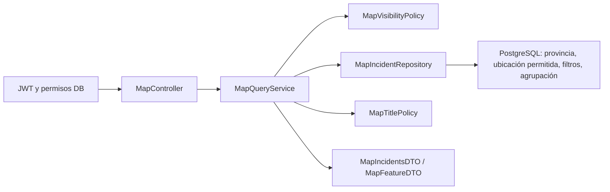

# Backend de Mapas de Urban Pulse

Entrega de 2026-11-10 en `feature/implementacion-mapas`. Endpoint implementado:
`GET /api/v1/map/incidents`. No hay cambios en frontend, Tramitación o Evidencias.

## Uso

```http
GET /api/v1/map/incidents?minLat=36&minLon=-6&maxLat=38&maxLon=-3&zoom=8 HTTP/1.1
Authorization: Bearer <JWT válido de una cuenta verificada>
```

Esta consulta abarca la provincia completa. El polígono oficial, no ese rectángulo,
decide qué incidencias pertenecen a Málaga. Para ver marcadores individuales en
el centro de Málaga:

```http
GET /api/v1/map/incidents?minLat=36.719&minLon=-4.424&maxLat=36.724&maxLon=-4.419&zoom=18 HTTP/1.1
Authorization: Bearer <JWT válido de una cuenta verificada>
```

Filtros opcionales: `&status=VALIDATED&categoryId=<UUID canónico>`. No hay filtros de
usuario, departamento o prioridad. Los límites son inclusivos; cada mínimo debe
ser menor que su máximo. Se rechazan no finitos, parámetros repetidos/desconocidos/
vacíos, estados inválidos, UUID inválidos y zoom fuera de 0..22. La amplitud máxima
por eje es `min(360,1440/2^zoom)` grados. Ningún endpoint de alta/edición cambia sus
validaciones geográficas.

Las respuestas reales de pruebas HTTP con datos sintéticos se conservan en
[`api/examples/maps-incident.json`](api/examples/maps-incident.json) y
[`api/examples/maps-cluster.json`](api/examples/maps-cluster.json), y se incorporan
a los ejemplos del OpenAPI modular. Para volver a capturarlas, ejecutar
`MapPostgresIT#jsonVariantsOmitPrivateFieldsAndCaptureRealHttpExamples`: los JSON
quedan en `backend/target/maps-examples`. No contienen JWT ni datos personales.

## Permisos y datos

| Solicitante                         | Propias, cualquier estado | Ajenas sin VALIDATE histórico | Ajenas con VALIDATE histórico |
| ----------------------------------- | ------------------------- | ----------------------------- | ----------------------------- |
| CITIZEN                             | Exactas                   | No visibles                   | Aproximadas                   |
| TECHNICIAN / DEPARTMENT_COORDINATOR | Exactas                   | No visibles                   | Aproximadas                   |
| OPERATOR / ADMIN global             | Exactas                   | Exactas                       | Exactas                       |

El conversor JWT consulta permisos actuales; el servicio los revalida en su propia
transacción. No se confía en roles del token ni del cliente. Las pertenencias de
departamento no amplían alcance. Se exige cuenta activa, CITIZEN base y correo
verificado, siguiendo la identidad del backend.

`canAccessPrivateDetail` solo es true para autor u OPERATOR/ADMIN global. El endpoint
privado `/incidents/{id}` conserva sus reglas. Una incidencia pública en el mapa no
da acceso al detalle. Se devuelve ID, etiqueta segura, categoría (ID y nombre) si
existe, estado, prioridad si existe, fecha de creación, coordenadas y precisión.
No se lee `Incident.title` ni descripción, informante u observaciones internas.
Todas las etiquetas actuales son `Incidencia <UUID>`; los opcionales ausentes se omiten.

Publicación: `EXISTS incident_reviews WHERE decision='VALIDATE'`. Un REJECT sin
validación nunca publica; cambiar de VALIDATED a RESOLVED/CLOSED/REJECTED no borra
la validación histórica. Múltiples revisiones no multiplican marcadores ni conteos.

## Ubicación y agrupaciones

El [recurso IGN](../backend/src/main/resources/maps/README.md) incluye fuente,
fecha de descarga, CRS, licencia, SHA-256 y reproducción offline. Se usa una
proyección métrica local con paralelo estándar 36.75° N. La cuadrícula pública
de 100 m es fija e independiente del zoom. En la costa/frontera, si su centro
queda fuera, se aproxima ese centro al contorno oficial; nunca se utiliza la
posición privada como punto de partida para ese ajuste.

Filtrar el viewport, asignar celdas y elegir coordenadas del cluster usa únicamente
ubicaciones autorizadas. Consultar rectángulos alrededor de la posición original
no descubre una incidencia ajena cuya posición pública está fuera de ese rectángulo.
La aproximación reduce precisión; **no garantiza anonimato**. Una celda no es un
radio de desplazamiento mínimo y el contexto puede revelar información adicional.

El lado de celda de agrupación es `100*2^(17-zoom)` m hasta zoom 17. A zoom 18 o
mayor se devuelven individuos, aunque coincidan. La cuadrícula está anclada a un
origen constante; los grupos no dependen de distancias al centro del viewport.
Se usa la ubicación autorizada del miembro de menor UUID para dibujar el grupo.
Los IDs `g1:zoom:columna:fila` son estables; su conteo es el del viewport actual,
no el de toda la celda fuera de pantalla.

- `type=INCIDENT`: una incidencia; sin campos de cluster.
- `type=CLUSTER`: `clusterId`, `coordinates`, `incidentCount` >= 2; sin detalle individual.
- `count`: número de elementos gráficos (`items.length`).
- `totalIncidents`: suma de incidencias representadas, no número de grupos.

## Límites y errores

| HTTP | Situación                                                                             |
| ---- | ------------------------------------------------------------------------------------- |
| 400  | Parámetros inválidos, área demasiado grande para zoom; INVALID_PARAMETER/HTTP_ERROR   |
| 401  | JWT ausente/inválido/revocado, cuenta inactiva o ausencia de rol base                 |
| 403  | Correo no verificado                                                                  |
| 422  | MAP_RESULT_LIMIT: más de 1000 elementos; reducir área o zoom                          |
| 429  | RATE_LIMITED: bucket por usuario de 60 peticiones y reposición 60/minuto; Retry-After |
| 503  | MAP_QUERY_TIMEOUT (5 s) o base de datos no disponible                                 |

Errores ProblemDetail, sin posiciones privadas ni mensajes SQL. Nunca se devuelve
una respuesta parcial ni un total falso por exceso de carga. Colección vacía es
200 con `items=[]`, `count=0`, `totalIncidents=0`. Respuestas 200 y 429 llevan
`Cache-Control: no-store` explícito y Spring Security protege las demás respuestas.

## Arquitectura



El repositorio JDBC devuelve como máximo 1001 proyecciones mínimas; no carga entidades
JPA ni hace N+1. PostgreSQL ejecuta el trabajo espacial y agregado con índices GiST
parciales exacto/público y un índice parcial VALIDATE. No se requiere extensión
PostGIS ni nuevas dependencias. El [ADR-0015](adr/0015-mapas-provinciales-privacidad.md)
documenta proyección, concurrencia, costes y alternativas.

## Integrar títulos aprobados de Tramitación

Tramitación debe persistir VALIDATE de forma atómica con la validación y proporcionar
una proyección por lote de títulos cuya aprobación siga vigente, vinculada a la
incidencia y versión aprobada. Adaptar `MapTitlePolicy` y, si hace falta, la proyección
SQL del repositorio o una única consulta por lote. No tocar controlador, cuadrícula,
DTO ni autorización del detalle. Usar etiqueta genérica ante ausencia, retirada o
aprobación obsoleta. Nunca hacer fallback a `Incident.title`; aprobar título sin
VALIDATE no publica. No se ha creado columna `public_title` ni endpoint de aprobación.

## Archivos de la entrega

Rutas relativas a la raíz del repositorio:

| Archivo/directorio                                                                                   | Cambio                                                                          |
| ---------------------------------------------------------------------------------------------------- | ------------------------------------------------------------------------------- |
| `backend/src/main/java/es/grupo18/urbanpulse/maps/api/MapController.java`                            | Endpoint, parámetros, cuota, no-store                                           |
| `backend/src/main/java/es/grupo18/urbanpulse/maps/service/MapQuery.java`                             | Límites y zoom                                                                  |
| `backend/src/main/java/es/grupo18/urbanpulse/maps/service/MapQueryService.java`                      | Transacción, orquestación, DTO, límites                                         |
| `backend/src/main/java/es/grupo18/urbanpulse/maps/service/MapVisibilityPolicy.java`                  | Permisos DB actuales                                                            |
| `backend/src/main/java/es/grupo18/urbanpulse/maps/service/MapTitlePolicy.java`                       | Etiquetas y futura integración                                                  |
| `backend/src/main/java/es/grupo18/urbanpulse/maps/repository/MapIncidentRepository.java`             | Consulta espacial y agregada                                                    |
| `backend/src/main/java/es/grupo18/urbanpulse/maps/dto/MapFeatureDTO.java`                            | Variantes individuales/grupos                                                   |
| `backend/src/main/java/es/grupo18/urbanpulse/maps/dto/MapIncidentsDTO.java`                          | Colección y totales                                                             |
| `backend/src/main/resources/maps/malaga-ign.geojson`, `maps/README.md`                               | Contorno oficial y procedencia                                                  |
| `backend/src/main/resources/db/migration/V5__maps_geography.sql`                                     | Funciones constantes e índices, aditiva                                         |
| `backend/scripts/generate-map-boundary.mjs`, `maps-functions.sql.template`                           | Generación reproducible offline                                                 |
| `backend/scripts/validate-map-contract.cjs`                                                          | Validación de respuestas capturadas contra OpenAPI y rechazo de campos privados |
| `backend/src/test/java/es/grupo18/urbanpulse/maps/service/MapQueryTest.java`                         | Parámetros y cuadrículas                                                        |
| `backend/src/test/java/es/grupo18/urbanpulse/maps/service/MapVisibilityPolicyTest.java`              | Autorización                                                                    |
| `backend/src/test/java/es/grupo18/urbanpulse/maps/service/MapQueryServiceTest.java`                  | Proyección, límites y errores                                                   |
| `backend/src/test/java/es/grupo18/urbanpulse/maps/integration/MapPostgresIT.java`                    | PostgreSQL y HTTP real de Spring Security/MVC                                   |
| `backend/pom.xml`                                                                                    | Incluir MapPostgresIT en perfil aislado                                         |
| `backend/src/test/java/es/grupo18/urbanpulse/auth/integration/AuthenticationPostgresIT.java`         | Acotar comprobación de migraciones base a V1–V3                                 |
| `backend/src/test/java/es/grupo18/urbanpulse/invitations/integration/StaffInvitationPostgresIT.java` | Acotar comprobación de migraciones base a V1–V3                                 |
| `backend/src/test/java/es/grupo18/urbanpulse/categories/integration/CategoryPostgresIT.java`         | Acotar comprobación de migraciones base a V1–V3                                 |
| `backend/src/test/java/es/grupo18/urbanpulse/organization/integration/DepartmentPostgresIT.java`     | Acotar comprobaciones de migraciones base a V1–V3                               |
| `backend/src/test/java/es/grupo18/urbanpulse/incidents/integration/IncidentPostgresIT.java`          | Acotar V1–V3 y mantener la prueba de actualización V2 a V3 en su ámbito         |
| `docs/api/openapi/paths/mapas.yaml`, `components/schemas/mapas.yaml`, `base-openapi.yaml`            | Contrato modular 0.7.0                                                          |
| `docs/api/openapi.yaml`, `docs/api/openapi.html`                                                     | Artefactos generados por Redocly                                                |
| `docs/api/examples/maps-incident.json`, `maps-cluster.json`                                          | Respuestas capturadas con datos sintéticos                                      |
| `docs/adr/0015-mapas-provinciales-privacidad.md`, `docs/adr/README.md`                               | Decisión e índice                                                               |
| `docs/architecture.md`, `docs/api/README.md`, `docs/development.md`, `docs/maps-backend.md`          | Integración y verificación                                                      |

## Verificación reproducible

```sh
node backend/scripts/generate-map-boundary.mjs --check
cd backend
mvn -B -ntp test
mvn -B -ntp clean verify -Ppostgres-it
cd ..
npx --yes @redocly/cli@2.16.0 lint docs/api/openapi/base-openapi.yaml
npx --yes @redocly/cli@2.16.0 bundle docs/api/openapi/base-openapi.yaml -o docs/api/openapi.yaml
npx --yes @redocly/cli@2.16.0 build-docs docs/api/openapi.yaml -o docs/api/openapi.html
npx --yes --package=@redocly/cli@2.16.0 -c "node backend/scripts/validate-map-contract.cjs"
git diff --check
```

El perfil PostgreSQL incorpora MapPostgresIT y excluye NeonConnectivityIT. No usa
credenciales, esquemas ni datos de Neon.

**Resultado del 10/11/2026:** `mvn -B -ntp clean verify -Ppostgres-it`, BUILD SUCCESS,
**291 pruebas**: 175 unitarias/MVC y 116 de integración PostgreSQL, cero fallos,
errores u omisiones. Mapas aporta 12 pruebas unitarias y 18 de integración, incluidas
peticiones HTTP al servidor real y actualización desde V3 con datos preexistentes.
Entorno Docker: Java 25.0.4.1, Maven 3.9.16, Spring Boot 4.1.2 y PostgreSQL 18.6.
Informes de esta ejecución en `backend/target/maps-verification/surefire-reports`,
`failsafe-reports` y `maps-build.log`, separados de informes antiguos que ya existían
en target. La compilación y empaquetado están incluidos en esa ejecución.

OpenAPI 0.7.0 válido con Redocly 2.16.0, cero errores y los dos avisos ya existentes
de licencia general no declarada y servidor localhost. Bundle/HTML generados con
los comandos oficiales. Respuestas HTTP capturadas verificadas frente a los esquemas
con AJV; el verificador también comprueba que se rechazan campos privados adicionales.
Reproducción del recurso IGN y `git diff --check` correctos.

## Límites operativos pendientes

No se ha desplegado a Neon ni publicado en GitHub. El rendimiento con volúmenes
productivos aún requiere medición: contorno detallado, índices y ajuste costero
añaden coste de escritura. La cuota es local por instancia. Actualizar el contorno
requiere nueva migración/funciones/índices, nunca modificar las funciones constantes
ya utilizadas por índices. La numeración temporal evita colisiones de nombres,
pero exige coordinar el orden de despliegue con migraciones de otras ramas: una V4
añadida después de desplegar esta versión no se ejecuta por defecto en Flyway.
