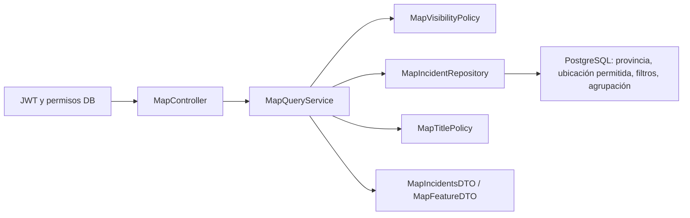

# Backend de Mapas de Urban Pulse

Entrega de 2026-11-10 en `feature/implementacion-mapas`. Endpoint implementado:
`GET /api/v1/map/incidents`. No hay cambios en frontend, Tramitación o Evidencias.

**Separación respecto a PostGIS:** el endpoint de Mapas usa los tipos nativos `point`,
`polygon`, `lseg`, `box`, funciones SQL versionadas e índices GiST nativos. No invoca
funciones PostGIS ni utiliza la tabla `cartografia.contexto_urbano`. La extensión
PostGIS y el catálogo de activos pertenecen al módulo independiente `urban_context`;
véase [PostGIS y contexto urbano](postgis-urban-context.md).

## Uso

```http
GET /api/v1/map/incidents?minLat=36&minLon=-6&maxLat=38&maxLon=-3&zoom=8 HTTP/1.1
Authorization: Bearer <JWT válido de una cuenta verificada>
```

Esta consulta abarca la provincia completa. El polígono oficial, no ese rectángulo,
decide qué incidencias pertenecen a Málaga. Para ver marcadores individuales en
el centro de Málaga:

```http
GET /api/v1/map/incidents?minLat=36.719&minLon=-4.424&maxLat=36.724&maxLon=-4.419&zoom=18 HTTP/1.1
Authorization: Bearer <JWT válido de una cuenta verificada>
```

Filtros opcionales: `&status=VALIDATED&categoryId=<UUID canónico>`. No hay filtros de
usuario, departamento o prioridad. Los límites son inclusivos; cada mínimo debe
ser menor que su máximo. Se rechazan no finitos, parámetros repetidos/desconocidos/
vacíos, estados inválidos, UUID inválidos y zoom fuera de 0..22. La amplitud máxima
por eje es `min(360,1440/2^zoom)` grados. Ningún endpoint de alta/edición cambia sus
validaciones geográficas.

Las respuestas reales de pruebas HTTP con datos sintéticos se conservan en
[`api/examples/maps-incident.json`](api/examples/maps-incident.json) y
[`api/examples/maps-cluster.json`](api/examples/maps-cluster.json), y se incorporan
a los ejemplos del OpenAPI modular. Para volver a capturarlas, ejecutar
`MapPostgresIT#jsonVariantsOmitPrivateFieldsAndCaptureRealHttpExamples`: los JSON
quedan en `backend/target/maps-examples`. No contienen JWT ni datos personales.

## Permisos y datos

| Solicitante                         | Propias, cualquier estado | Ajenas sin VALIDATE histórico | Ajenas con VALIDATE histórico |
| ----------------------------------- | ------------------------- | ----------------------------- | ----------------------------- |
| CITIZEN                             | Exactas                   | No visibles                   | Aproximadas                   |
| TECHNICIAN / DEPARTMENT_COORDINATOR | Exactas                   | No visibles                   | Aproximadas                   |
| OPERATOR / ADMIN global             | Exactas                   | Exactas                       | Exactas                       |

El conversor JWT consulta permisos actuales; el servicio los revalida en su propia
transacción. No se confía en roles del token ni del cliente. Las pertenencias de
departamento no amplían alcance. Se exige cuenta activa, CITIZEN base y correo
verificado, siguiendo la identidad del backend.

`canAccessPrivateDetail` solo es true para autor u OPERATOR/ADMIN global. El endpoint
privado `/incidents/{id}` conserva sus reglas. Una incidencia pública en el mapa no
da acceso al detalle. Se devuelve ID, etiqueta segura, categoría (ID y nombre) si
existe, estado, prioridad si existe, fecha de creación, coordenadas y precisión.
No se lee `Incident.title` ni descripción, informante u observaciones internas.
Todas las etiquetas actuales son `Incidencia <UUID>`; los opcionales ausentes se omiten.

Publicación: `EXISTS incident_reviews WHERE decision='VALIDATE'`. Un REJECT sin
validación nunca publica; cambiar de VALIDATED a RESOLVED/CLOSED/REJECTED no borra
la validación histórica. Múltiples revisiones no multiplican marcadores ni conteos.

## Ubicación y agrupaciones

El [recurso IGN](../backend/src/main/resources/maps/README.md) incluye fuente,
fecha de descarga, CRS, licencia, SHA-256 y reproducción offline. Se usa una
proyección métrica local con paralelo estándar 36.75° N. La cuadrícula pública
de 100 m es fija e independiente del zoom. En la costa/frontera, si su centro
queda fuera, se aproxima ese centro al contorno oficial; nunca se utiliza la
posición privada como punto de partida para ese ajuste.

Filtrar el viewport, asignar celdas y elegir coordenadas del cluster usa únicamente
ubicaciones autorizadas. Consultar rectángulos alrededor de la posición original
no descubre una incidencia ajena cuya posición pública está fuera de ese rectángulo.
La aproximación reduce precisión; **no garantiza anonimato**. Una celda no es un
radio de desplazamiento mínimo y el contexto puede revelar información adicional.

El lado de celda de agrupación es `100*2^(17-zoom)` m hasta zoom 17. A zoom 18 o
mayor se devuelven individuos, aunque coincidan. La cuadrícula está anclada a un
origen constante; los grupos no dependen de distancias al centro del viewport.
Se usa la ubicación autorizada del miembro de menor UUID para dibujar el grupo.
Los IDs `g1:zoom:columna:fila` son estables; su conteo es el del viewport actual,
no el de toda la celda fuera de pantalla.

- `type=INCIDENT`: una incidencia; sin campos de cluster.
- `type=CLUSTER`: `clusterId`, `coordinates`, `incidentCount` >= 2; sin detalle individual.
- `count`: número de elementos gráficos (`items.length`).
- `totalIncidents`: suma de incidencias representadas, no número de grupos.

## Límites y errores

| HTTP | Situación                                                                             |
| ---- | ------------------------------------------------------------------------------------- |
| 400  | Parámetros inválidos, área demasiado grande para zoom; INVALID_PARAMETER/HTTP_ERROR   |
| 401  | JWT ausente/inválido/revocado, cuenta inactiva o ausencia de rol base                 |
| 403  | Correo no verificado                                                                  |
| 422  | MAP_RESULT_LIMIT: más de 1000 elementos; reducir área o zoom                          |
| 429  | RATE_LIMITED: bucket por usuario de 60 peticiones y reposición 60/minuto; Retry-After |
| 503  | MAP_QUERY_TIMEOUT (5 s) o base de datos no disponible                                 |

Errores ProblemDetail, sin posiciones privadas ni mensajes SQL. Nunca se devuelve
una respuesta parcial ni un total falso por exceso de carga. Colección vacía es
200 con `items=[]`, `count=0`, `totalIncidents=0`. Respuestas 200 y 429 llevan
`Cache-Control: no-store` explícito y Spring Security protege las demás respuestas.

## Arquitectura



El repositorio JDBC devuelve como máximo 1001 proyecciones mínimas; no carga entidades
JPA ni hace N+1. PostgreSQL ejecuta el trabajo espacial y agregado con índices GiST
parciales exacto/público y un índice parcial VALIDATE. No se requiere extensión
PostGIS ni nuevas dependencias. El [ADR-0017](adr/0017-mapas-provinciales-privacidad.md)
documenta proyección, concurrencia, costes y alternativas.

Desde la corrección del 15/11/2026, la rama pública reutiliza la ubicación por celda
de privacidad de 100 m dentro de cada consulta. Los candidatos autorizados se
preseleccionan mediante el índice exacto y un bbox ampliado 150 m por eje; después
se materializa un representante por celda y se evalúa una sola vez la función
original `map_public_point_v1`. El desplazamiento máximo teórico es 100√2 m, menor
que ese margen. El filtro definitivo usa el punto público y el bbox solicitado;
los conteos y clústeres se calculan después. Así se conserva la privacidad incluso
cuando el original está fuera del viewport y su ubicación pública dentro.
La optimización histórica no cambió la geografía; esta integración la traslada íntegra a V1 y conserva el timeout de 5 s.
La rama exacta permanece igual. No hay almacenamiento adicional ni caché persistente.

## Integrar títulos aprobados de Tramitación

Tramitación debe persistir VALIDATE de forma atómica con la validación y proporcionar
una proyección por lote de títulos cuya aprobación siga vigente, vinculada a la
incidencia y versión aprobada. Adaptar `MapTitlePolicy` y, si hace falta, la proyección
SQL del repositorio o una única consulta por lote. No tocar controlador, cuadrícula,
DTO ni autorización del detalle. Usar etiqueta genérica ante ausencia, retirada o
aprobación obsoleta. Nunca hacer fallback a `Incident.title`; aprobar título sin
VALIDATE no publica. No se ha creado columna `public_title` ni endpoint de aprobación.

## Archivos de la entrega

Rutas relativas a la raíz del repositorio:

| Archivo/directorio                                                                                   | Cambio                                                                          |
| ---------------------------------------------------------------------------------------------------- | ------------------------------------------------------------------------------- |
| `backend/src/main/java/es/grupo18/urbanpulse/maps/api/MapController.java`                            | Endpoint, parámetros, cuota, no-store                                           |
| `backend/src/main/java/es/grupo18/urbanpulse/maps/service/MapQuery.java`                             | Límites y zoom                                                                  |
| `backend/src/main/java/es/grupo18/urbanpulse/maps/service/MapQueryService.java`                      | Transacción, orquestación, DTO, límites                                         |
| `backend/src/main/java/es/grupo18/urbanpulse/maps/service/MapVisibilityPolicy.java`                  | Permisos DB actuales                                                            |
| `backend/src/main/java/es/grupo18/urbanpulse/maps/service/MapTitlePolicy.java`                       | Etiquetas y futura integración                                                  |
| `backend/src/main/java/es/grupo18/urbanpulse/maps/repository/MapIncidentRepository.java`             | Consulta espacial y agregada                                                    |
| `backend/src/main/java/es/grupo18/urbanpulse/maps/dto/MapFeatureDTO.java`                            | Variantes individuales/grupos                                                   |
| `backend/src/main/java/es/grupo18/urbanpulse/maps/dto/MapIncidentsDTO.java`                          | Colección y totales                                                             |
| `backend/src/main/resources/maps/malaga-ign.geojson`, `maps/README.md`                               | Contorno oficial y procedencia                                                  |
| `backend/src/main/resources/db/migration/V1__initial_schema.sql`                                     | Esquema consolidado con funciones constantes e índices                                         |
| `backend/scripts/generate-map-boundary.mjs`, `maps-functions.sql.template`                           | Generación reproducible offline                                                 |
| `backend/scripts/validate-map-contract.cjs`                                                          | Validación de respuestas capturadas contra OpenAPI y rechazo de campos privados |
| `backend/src/test/java/es/grupo18/urbanpulse/maps/service/MapQueryTest.java`                         | Parámetros y cuadrículas                                                        |
| `backend/src/test/java/es/grupo18/urbanpulse/maps/service/MapVisibilityPolicyTest.java`              | Autorización                                                                    |
| `backend/src/test/java/es/grupo18/urbanpulse/maps/service/MapQueryServiceTest.java`                  | Proyección, límites y errores                                                   |
| `backend/src/test/java/es/grupo18/urbanpulse/maps/integration/MapPostgresIT.java`                    | PostgreSQL y HTTP real de Spring Security/MVC                                   |
| `backend/src/test/java/es/grupo18/urbanpulse/maps/integration/MapPerformancePostgresIT.java`         | Regresión costera y comparación de planes con 1.000, 10.000 y 50.000 incidencias |
| `backend/src/test/resources/maps/citizen-query-before-cell-reuse.sql`                               | SQL anterior de `8704ac1`, solo para comparar resultados y rendimiento           |
| `backend/pom.xml`                                                                                    | Incluir pruebas de Mapas en perfil aislado                                      |
| `backend/src/test/java/es/grupo18/urbanpulse/auth/integration/AuthenticationPostgresIT.java`         | Verificar la única V1 consolidada                                 |
| `backend/src/test/java/es/grupo18/urbanpulse/invitations/integration/StaffInvitationPostgresIT.java` | Verificar la única V1 consolidada                                 |
| `backend/src/test/java/es/grupo18/urbanpulse/categories/integration/CategoryPostgresIT.java`         | Verificar la única V1 consolidada                                 |
| `backend/src/test/java/es/grupo18/urbanpulse/organization/integration/DepartmentPostgresIT.java`     | Verificar la única V1 consolidada                               |
| `backend/src/test/java/es/grupo18/urbanpulse/incidents/integration/IncidentPostgresIT.java`          | Verificar esquema final consolidado, índices e invariantes         |
| `docs/api/openapi/paths/mapas.yaml`, `components/schemas/mapas.yaml`, `base-openapi.yaml`            | Contrato modular 0.8.0                                                          |
| `docs/api/openapi.yaml`, `docs/api/openapi.html`                                                     | Artefactos generados por Redocly                                                |
| `docs/api/examples/maps-incident.json`, `maps-cluster.json`                                          | Respuestas capturadas con datos sintéticos                                      |
| `docs/adr/0017-mapas-provinciales-privacidad.md`, `docs/adr/README.md`                               | Decisión e índice                                                               |
| `docs/architecture.md`, `docs/api/README.md`, `docs/development.md`, `docs/maps-backend.md`          | Integración y verificación                                                      |

## Verificación reproducible

Los resultados numéricos de esta sección pertenecen a C y sus antecedentes. La validación de la integración actual está en [el informe de integración](integration-reconciliation.md).

```sh
node backend/scripts/generate-map-boundary.mjs --check
cd backend
mvn -B -ntp test
mvn -B -ntp clean verify -Ppostgres-it
cd ..
npx --yes @redocly/cli@2.16.0 lint docs/api/openapi/base-openapi.yaml
npx --yes @redocly/cli@2.16.0 bundle docs/api/openapi/base-openapi.yaml -o docs/api/openapi.yaml
npx --yes @redocly/cli@2.16.0 build-docs docs/api/openapi.yaml -o docs/api/openapi.html
npx --yes --package=@redocly/cli@2.16.0 -c "node backend/scripts/validate-map-contract.cjs"
git diff --check
```

El perfil PostgreSQL incorpora MapPostgresIT y MapPerformancePostgresIT y excluye NeonConnectivityIT. No usa
credenciales, esquemas ni datos de Neon.

La prueba de rendimiento compara filas completas con el SQL anterior y verifica
en `pg_stat_xact_user_functions` una llamada por celda pública candidata. Cubre
1.000 incidencias en una celda costera, bbox diminutos públicos/privados, permisos,
historial VALIDATE, filtros, conteos, clústeres y el centinela de 1.001 elementos.
La carga mixta de 1.000/10.000/50.000 registros incluye Málaga, Marbella, Ronda y
puntos exteriores, autores distintos y estados/historiales diferentes.
Por escenario guarda tres pares de `EXPLAIN (ANALYZE, BUFFERS, FORMAT JSON, TIMING OFF)`
alternando el orden, junto a los tiempos, en `target/maps-performance`.
Solo el comparador del SQL antiguo permite 30 s para medir el caso que fallaba;
las consultas del servicio se comprueban con su timeout original de 5 s.

**Resultado del 10/11/2026:** `mvn -B -ntp clean verify -Ppostgres-it`, BUILD SUCCESS,
**291 pruebas**: 175 unitarias/MVC y 116 de integración PostgreSQL, cero fallos,
errores u omisiones. Mapas aporta 12 pruebas unitarias y 18 de integración, incluidas
peticiones HTTP al servidor real y actualización desde V3 con datos preexistentes.
Entorno Docker: Java 25.0.4.1, Maven 3.9.16, Spring Boot 4.1.2 y PostgreSQL 18.6.
Informes de esta ejecución en `backend/target/maps-verification/surefire-reports`,
`failsafe-reports` y `maps-build.log`, separados de informes antiguos que ya existían
en target. La compilación y empaquetado están incluidos en esa ejecución.

OpenAPI 0.7.0 válido con Redocly 2.16.0, cero errores y los dos avisos ya existentes
de licencia general no declarada y servidor localhost. Bundle/HTML generados con
los comandos oficiales. Respuestas HTTP capturadas verificadas frente a los esquemas
con AJV; el verificador también comprueba que se rechazan campos privados adicionales.
Reproducción del recurso IGN y `git diff --check` correctos.

### Medición de P1 (15/11/2026)

`mvn -B -ntp clean verify -Ppostgres-it`: **BUILD SUCCESS, 295 pruebas**
(175 unitarias/MVC y 120 de integración), sin fallos, errores ni omisiones.
Las pruebas de Mapas también se ejecutaron por separado: 12 unitarias y 22 de
integración, todas correctas. Compilación y empaquetado incluidos. Java 25.0.4.1,
Maven 3.9.16, Spring Boot 4.1.2 y PostgreSQL 18.6; exclusivamente Testcontainers.
El log y los informes Surefire/Failsafe de la suite completa están en
`backend/target/maps-fix-full-verification`. No se modifica ni regenera OpenAPI
en esta corrección porque el contrato no cambia.

Comparación del SQL de `8704ac1` con la consulta por celdas sobre los mismos datos
y servidor PostgreSQL 18.6 de Testcontainers. Medianas de tres ejecuciones de
EXPLAIN por variante, con caché calentada por la comprobación previa de igualdad
de filas. Son tiempos SQL, no latencias HTTP ni resultados de carga concurrente.

| Datos / consulta | Antes (ms) | Después (ms) |
| --- | ---: | ---: |
| 1.000 en una celda costera, provincia | 4.728,402 | 9,460 |
| 1.000 costeras, estado y categoría | 1.732,169 | 8,102 |
| 1.000 mixtas, provincia | 21,870 | 29,988 |
| 1.000 mixtas, ciudad | 12,578 | 17,249 |
| 1.000 mixtas, estado y categoría | 1,773 | 2,315 |
| 1.000 mixtas, zoom 18 | 5,431 | 4,166 |
| 10.000 mixtas, provincia | 190,006 | 305,367 |
| 10.000 mixtas, ciudad | 124,478 | 132,886 |
| 10.000 mixtas, estado y categoría | 15,700 | 7,822 |
| 10.000 mixtas, zoom 18 | 112,766 | 69,039 |
| 50.000 mixtas, provincia | 946,278 | 139,488 |
| 50.000 mixtas, ciudad | 618,497 | 87,060 |
| 50.000 mixtas, estado y categoría | 86,938 | 31,270 |
| 50.000 mixtas, zoom 18 | 171,555 | 29,140 |

La celda costera mejora aproximadamente **500 veces**; las tres medidas anteriores
fueron 5.350,517 / 4.728,402 / 4.713,056 ms y las nuevas 9,460 / 11,112 / 8,320 ms.
La prueba confirma exactamente una llamada a `map_public_point_v1` para sus 1.000
incidencias y conserva un clúster de 1.000, o 1.000 individuos al acercar el zoom.
Con 50.000 registros, la vista provincial representa las mismas 33.000 incidencias
autorizadas que antes y mejora unas 6,8 veces. Los zooms 18 de 10.000/50.000 superan
el límite de elementos: ambas consultas producen el mismo centinela y el servicio
responde MAP_RESULT_LIMIT, sin presentar ese límite como un total de incidencias.

Los planes muestran `maps_exact_location_idx` en la preselección espacial y
`maps_validated_review_idx` para VALIDATE; el índice público se conserva sin usarlo
en la nueva rama pública. No hay mejora uniforme: la vista provincial de 10.000
registros añade unos 115 ms. Las estimaciones bajas favorecen un nested loop entre
563 celdas y 4.800 candidatos, con unos 2,7 millones de comparaciones descartadas.
Es un sobrecoste medido de esta estrategia, aunque la consulta queda en unos 305 ms
y no alcanza el timeout. No se fuerzan planes ni se aborda la refactorización P2.
Las demás pruebas de carga mantienen resultados, privacidad y límite de 5 s.

Los planes completos, incluidos BUFFERS, y los JSON de tiempos se conservan en
`backend/target/maps-fix-full-verification/maps-performance`; la ejecución específica
de Mapas queda separada en `backend/target/maps-fix-verification`. Son artefactos
locales ignorados por Git y se regeneran con la prueba de rendimiento.

## Integración anterior de Evidencias y CI (16/11/2026)

La integración anterior combinó V1 consolidada (incluidas Evidencias) con V5 de Mapas
sin cambios. Las pruebas de Mapas limpian attachments junto con incidents y la
prueba de construcción de índices parte de V1 con datos. ADR-0017 sustituye la
numeración anterior de este módulo; ADR-0015 corresponde a Evidencias y ADR-0016 a CI.

Suite completa `mvn -B -ntp clean verify -Ppostgres-it`: **319 pruebas correctas**
(183 unitarias/MVC + 136 PostgreSQL), incluidas las 34 de Mapas, las 16 IT de Evidencias
y las 8 de imágenes. No se omiten pruebas del perfil. Los planes de rendimiento y
los informes de esta integración están en `backend/target/maps-merge-verification`.
La celda costera sigue evaluándose una sola vez para 1.000 incidencias; la mediana
SQL pasa de 6.826,626 ms con el SQL anterior a 11,264 ms con la consulta por celdas
sobre el esquema integrado. Los escenarios mixtos de 10.000 y 50.000 también pasan.
Estas mediciones no sustituyen las de la corrección P1 fechadas arriba.

## Compatibilidad con Tramitación fase 1

V1 consolidada incorpora AWAITING_INFORMATION y exige resulting_status en todas las revisiones.
Mapas acepta el estado mediante el enum compartido, sin añadir rutas ni cambiar DTO.
REPORTED, AWAITING_INFORMATION y REJECTED propios siguen visibles con precisión
exacta; para terceros la publicación exige un VALIDATE histórico. REQUEST_INFORMATION,
las respuestas del informante y REJECT no publican. Dos ciclos de solicitud/respuesta
seguidos de VALIDATE generan un solo marcador aproximado, sin multiplicar el conteo.
**Antecedente anterior a la consolidación:** las revisiones de la V1 antigua con resulting_status desconocido conservaban su valor histórico y
la visibilidad por VALIDATE: el snapshot nuevo no se usa como criterio de publicación.

OPERATOR/ADMIN global mantienen coordenadas exactas. Los demás permisos no se amplían.
Que una incidencia aparezca en Mapas no permite acceder a su detalle privado,
attachments, review-outcome ni information-responses. Los títulos siguen siendo
etiquetas genéricas: esta fase de Tramitación aún no proporciona título aprobado.
No se publica título original, motivo, mensaje ni identidad municipal en Mapas.
Evidencias conserva la nueva regla de main: altas/bajas solo en REPORTED o
AWAITING_INFORMATION y lecturas autorizadas también después de validar/rechazar.

**Antecedente histórico de C `50d7ed7`:** la secuencia desde vacío era V1 → V2 → V5, con las tres migraciones intactas. V5 se
prueba sobre V1/V2 con datos; para una base anterior V1/V5 véase el procedimiento de
[ADR-0006](adr/0006-flyway.md#v2-recibida-después-de-v5). No se activa outOfOrder global.

### Verificación histórica de C del 16/11/2026 (anterior a esta integración)

`mvn -B -ntp clean verify -Ppostgres-it`: **351 pruebas correctas**, 187 unitarias/MVC
y 164 PostgreSQL, sin fallos, errores ni omisiones. Mapas conserva sus 12 unitarias,
18 IT previas y 4 de rendimiento; añade 2 casos de integración con ciclos reales de
Tramitación. Las 19 IT de Evidencias y las 21 de Tramitación/migraciones pasan juntas.
La prueba de V2 tardía verifica rechazo por defecto y un ensayo explícito en una
base desechable, sin cambiar configuración global ni checksums. Los logs, planes
 y respuestas están en `backend/target/maps-processing-merge-verification`.
Las mediciones se ejecutaron junto con comprobaciones frontend; sirven de regresión,
no de comparación controlada con los tiempos de P1 anteriores. El timeout sigue en 5 s.

## Límites operativos pendientes

Esta integración no se ha desplegado a Neon ni publicado en GitHub. Las mediciones
sintéticas no sustituyen una evaluación de carga concurrente representativa de
producción. Contorno detallado, índices y ajuste costero añaden coste de escritura;
esta optimización solo reduce cálculos durante la lectura. La cuota es local por instancia. Actualizar el contorno
requiere nueva migración/funciones/índices, nunca modificar las funciones constantes
ya utilizadas por índices. En C, antes de esta consolidación, la secuencia era V1 → V2 → V5.
En aquel estado C, Evidencias estaba en V1 y V2 era processing_phase_one. Actualmente todo forma parte de V1; no hay actualización incremental desde ese historial.
La región geográfica de V1 conserva las funciones de C sin cambios. Un historial anterior necesita una transición revisada,
no repair ni outOfOrder para ocultar diferencias. Las estimaciones de cardinalidad
(P2) quedan fuera de esta integración.

## Integración actual (16/11/2026)

La geografía antes entregada en V5 está integrada sin cambios matemáticos en la región marcada de V1. Las mediciones y secuencias anteriores de esta guía son históricas. No hay V2/V3/V5 ejecutables. La huella exige bytes LF originales; .gitattributes evita conversiones CRLF del GeoJSON. SVG pendientes de exportación manual.
