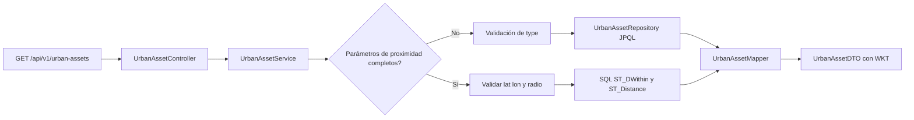

# PostGIS y contexto urbano

> **Estado de la revisión: 17/11/2026.** El repositorio contiene una migración Flyway V2 para PostGIS y un módulo Java `urban_context` que consulta activos urbanos. La API de búsqueda `GET /api/v1/urban-assets` existe en el controlador, aunque el OpenAPI anterior la marcaba como futura. La integración operativa de la migración y la prueba de extremo a extremo requieren resolver los puntos de configuración indicados en esta guía.

## 1. Alcance y separación de módulos

UrbanPulse tiene dos subsistemas geográficos distintos:

| Subsistema | Responsabilidad | Tecnología | Estado |
|---|---|---|---|
| Contexto urbano (`urban_context`) | Catálogo unificado de activos urbanos y búsqueda por proximidad | PostGIS, geometrías JTS y SQL espacial | Migración V2, entidad/repositorio/servicio/controlador presentes |
| Mapas (`maps`) | Publicación de incidencias de Málaga, privacidad y agrupación por zoom | Tipos `point`, `polygon`, `lseg`, `box`, funciones SQL propias e índices GiST nativos | Backend implementado; visor frontend pendiente |

La extensión PostGIS no forma parte del algoritmo del mapa de incidencias. El hecho de que la base de datos tenga PostGIS instalado no convierte las funciones `map_*_v1` en funciones PostGIS. Véanse [Backend de Mapas](maps-backend.md) y [ADR-0017](adr/0017-mapas-provinciales-privacidad.md).

## 2. Persistencia PostGIS

La migración `backend/src/main/resources/db/migration/V2__create_cartografia.sql` realiza estas operaciones:

1. `CREATE EXTENSION IF NOT EXISTS postgis`.
2. Crea el esquema `cartografia`.
3. Crea `cartografia.contexto_urbano`.
4. Crea un índice GiST sobre `geom` y un índice B-tree sobre `source_table`.

### Tabla `cartografia.contexto_urbano`

| Columna | Tipo | Nulabilidad / significado |
|---|---|---|
| `id` | `BIGINT GENERATED BY DEFAULT AS IDENTITY` | PK |
| `source_table` | `VARCHAR(64)` | NOT NULL; nombre de la tabla/conjunto de origen |
| `name` | `VARCHAR(255)` | Nombre opcional |
| `category` | `VARCHAR(64)` | Categoría opcional; los valores de origen pueden estar sucios |
| `description` | `VARCHAR(500)` | Descripción opcional |
| `address` | `VARCHAR(255)` | Dirección textual opcional |
| `phone` | `VARCHAR(32)` | Teléfono opcional |
| `email` | `VARCHAR(128)` | Correo opcional |
| `url` | `VARCHAR(512)` | URL opcional |
| `geom` | `geometry(Geometry,25830)` | Geometría PostGIS con SRID 25830; nullable en SQL |

`geometry(Geometry,25830)` admite subtipos geométricos diferentes, no solo `Point`. Los datos creados por `UrbanAsset.create` exigen una geometría no nula y no vacía, pero la migración no declara `geom NOT NULL` ni una restricción SQL de no vacío: una inserción externa directa puede incumplir la invariante de la aplicación. Tampoco hay una restricción que fuerce el subtipo `POINT`.

### SRID y unidades

- **EPSG:25830 — ETRS89 / UTM zona 30N.**
- Las coordenadas almacenadas son métricas (metros) en la zona UTM 30.
- El API recibe `latitude` y `longitude` en grados WGS84 (EPSG:4326).
- La consulta construye un punto con `ST_MakePoint(longitude, latitude)`, asigna SRID 4326 con `ST_SetSRID` y lo transforma a 25830 mediante `ST_Transform`.
- El radio de `ST_DWithin` se expresa en metros porque ambas geometrías comparadas están en 25830.

No se deben intercambiar latitud y longitud: JTS/PostGIS `Point` usa X/Y, por tanto X=longitud/este y Y=latitud/norte.

## 3. Índices y consultas

- `idx_contexto_urbano_geom`: GiST sobre `geom`; permite acelerar predicados espaciales como `ST_DWithin`.
- `idx_contexto_urbano_source_table`: B-tree sobre `source_table`; permite filtrar por conjunto de origen.

El repositorio `UrbanAssetRepository` contiene dos estrategias:

**Listado por origen (`searchBySourceTable`)**

JPQL sobre la entidad `UrbanAsset`, con filtro opcional por `sourceTable` y orden `id` ascendente. Si `type` no se envía o queda vacío tras `strip()`, no se filtra por origen.

**Proximidad (`searchByProximity`)**

SQL nativo que combina el filtro opcional `source_table`, `ST_DWithin(geom, punto_transformado, radius)` y orden por `ST_Distance` ascendente. El servicio acepta radios entre 1 y 5.000 metros. El repositorio aplica `LIMIT 500` a esta consulta.

> **Límite que debe corregirse/verificarse:** `MAX_RESULTS = 500` y el comentario de “tope duro” también aparecen asociados al listado, pero `searchBySourceTable` no incorpora `LIMIT`, `Pageable` ni `setMaxResults`. Por tanto, el tope 500 solo está implementado en la consulta de proximidad; no debe prometerse como límite del listado sin cambiar el repositorio.

## 4. API implementada: búsqueda de activos

`UrbanAssetController` expone `GET /api/v1/urban-assets`. Requiere autenticación JWT de acuerdo con la cadena de seguridad compartida y es una consulta de solo lectura. No existe en este módulo una operación de escritura, asociación con incidencias ni consulta individual por ID.

### Parámetros

| Parámetro | Obligatorio | Rango / formato | Descripción |
|---|---|---|---|
| `type` | No | Texto; se recortan espacios exteriores | Coincide exactamente con `source_table` |
| `latitude` | En grupo | [-90, 90] | Latitud WGS84 |
| `longitude` | En grupo | [-180, 180] | Longitud WGS84 |
| `radiusMeters` | En grupo | [1, 5000] | Radio en metros |

Los tres parámetros de proximidad deben enviarse juntos o ninguno. Enviar solo uno o dos devuelve `400 INCOMPLETE_PROXIMITY_PARAMETERS`. Los valores fuera de rango producen `400 INVALID_LATITUDE`, `INVALID_LONGITUDE` o `INVALID_RADIUS`. Si no hay resultados, la respuesta es `200` con una lista vacía.

Ejemplos:

```http
GET /api/v1/urban-assets?type=Ferrocarriles
Authorization: Bearer <JWT>
```

```http
GET /api/v1/urban-assets?latitude=37.3891&longitude=-5.9845&radiusMeters=500
Authorization: Bearer <JWT>
```

```http
GET /api/v1/urban-assets?type=Aparcamientos&latitude=37.3891&longitude=-5.9845&radiusMeters=5000
Authorization: Bearer <JWT>
```

### DTO real

`UrbanAssetDTO` devuelve:

| Campo | Tipo JSON | Observación |
|---|---|---|
| `id` | integer/int64 | Identidad numérica de la tabla |
| `sourceTable` | string | Conjunto de origen |
| `name`, `category`, `description`, `address`, `phone`, `email`, `url` | string o null | Metadatos opcionales |
| `geom` | string | WKT sin prefijo `SRID=`, con SRID conocido por contrato: 25830 |

La geometría se serializa mediante `WKTWriter` en `UrbanAssetMapper`. Ejemplo de forma: `"POINT (439000 4473000)"`. WKT no incluye el SRID en la cadena; el consumidor debe conocer EPSG:25830 por el contrato. El DTO no devuelve GeoJSON ni reproyecta la geometría a WGS84.

## 5. Flujo de ejecución



El servicio se ejecuta `@Transactional(readOnly = true)`. No se realiza geocodificación, enriquecimiento externo, asociación automática, caché, sincronización de fuentes ni escritura desde el API.

## 6. Implementado frente a diseño futuro

| Elemento | Estado |
|---|---|
| `UrbanAsset` como entidad JPA de `cartografia.contexto_urbano` | Implementado |
| Búsqueda por `source_table` | Implementada |
| Búsqueda por radio con `ST_DWithin` y orden por distancia | Implementada |
| Serialización de geometría a WKT | Implementada |
| `GET /urban-assets` | Implementado en Java; contrato OpenAPI actualizado en esta revisión |
| Límite de 500 para búsqueda por proximidad | Implementado |
| Límite de 500 para listado por origen | No garantizado por el código actual |
| `GET /urban-assets/{assetId}` | Futuro; no hay método de controlador |
| `GET /incidents/{incidentId}/urban-context` | Futuro |
| `GET /incidents/{incidentId}/asset-candidates` | Futuro |
| `PUT /incidents/{incidentId}/asset-association` | Futuro |
| `ExternalSource`, `ExternalObservation`, sincronización de proveedores | Futuro |
| Asociación confirmada/inferida, confianza, procedencia e historial | Futuro |
| Geocodificación, distritos y barrios | Futuro |

El esquema `UrbanAssetDTO` conceptual del diseño de dominio (UUID, `externalId`, `coordinates`, `metadata`) no es el DTO devuelto por este endpoint. El contrato HTTP de búsqueda utiliza `UrbanAssetRecordDTO` con ID numérico y geometría WKT. No deben mezclarse ambos modelos.

## 7. Pruebas y límites de validación

Existe `UrbanAssetControllerIT`, que prueba el recorrido HTTP → servicio → repositorio → PostGIS → JSON, incluyendo proximidad, filtro de tipo, JWT, radio fuera de rango y parámetros incompletos. Usa Testcontainers `postgis/postgis:16-3.4`, configura `ddl-auto=create-drop` y un dialecto PostGIS explícito.

Sin embargo:

- `UrbanAssetControllerIT` no aparece en la lista `includes` del perfil Maven `postgres-it` de `backend/pom.xml`; el perfil CI no demuestra por sí mismo que esta prueba se ejecute.
- La prueba usa una imagen PostGIS 16, mientras que las demás suites PostgreSQL del repositorio usan `postgis/postgis:18-3.6-alpine`.
- `backend/pom.xml` declara `jts-core`, pero no declara explícitamente `hibernate-spatial`. Debe comprobarse la integración JPA/Hibernate con el tipo `Geometry` en un arranque real; JTS por sí solo no acredita el mapeo Hibernate de PostGIS.

## 8. Bloqueos de configuración antes de considerar el módulo operativo

Hay dos discrepancias verificables entre el módulo y la configuración común:

1. `compose.yaml` utiliza `postgres:18-alpine`, imagen PostgreSQL estándar, mientras que Flyway carga `classpath:db/migration` y el repositorio contiene V2, que ejecuta `CREATE EXTENSION ... postgis`. La imagen estándar no incluye los binarios/extensión PostGIS. El Compose actual no es compatible con V2 tal como está escrito; el arranque debe probarse con una imagen PostgreSQL que incluya la versión compatible de PostGIS o con una estrategia de despliegue equivalente.
2. La entidad JPA declara `@Table(name="contexto_urbano", schema="cartografia")`, pero la consulta SQL nativa de proximidad usa `FROM contexto_urbano` sin calificar el esquema. Con el `search_path` PostgreSQL habitual (`"$user", public`) la tabla está en `cartografia` y no se resuelve por ese nombre. La consulta debe calificar `cartografia.contexto_urbano` o la aplicación debe establecer y verificar explícitamente un `search_path` que incluya `cartografia`.

Además, el permiso para `CREATE EXTENSION postgis` depende de la oferta y privilegios de la base gestionada. La disponibilidad debe verificarse en el proveedor de destino; no se infiere de que la migración exista ni de que una prueba local use la imagen PostGIS.

Hasta resolver y validar estos puntos, distinguir entre **código presente**, **migración versionada**, **contrato publicado** y **despliegue ejecutado**. No afirmar que V2 se ha aplicado en Neon ni que el Compose estándar arranca correctamente con V2.

## 9. Referencias del repositorio

- Migración: [`backend/src/main/resources/db/migration/V2__create_cartografia.sql`](../backend/src/main/resources/db/migration/V2__create_cartografia.sql).
- Entidad: [`UrbanAsset.java`](../backend/src/main/java/es/grupo18/urbanpulse/urban_context/model/UrbanAsset.java).
- Repositorio: [`UrbanAssetRepository.java`](../backend/src/main/java/es/grupo18/urbanpulse/urban_context/repository/UrbanAssetRepository.java).
- Servicio: [`UrbanAssetService.java`](../backend/src/main/java/es/grupo18/urbanpulse/urban_context/service/UrbanAssetService.java).
- Controlador: [`UrbanAssetController.java`](../backend/src/main/java/es/grupo18/urbanpulse/urban_context/api/UrbanAssetController.java).
- DTO y mapper: [`UrbanAssetDTO.java`](../backend/src/main/java/es/grupo18/urbanpulse/urban_context/dto/UrbanAssetDTO.java), [`UrbanAssetMapper.java`](../backend/src/main/java/es/grupo18/urbanpulse/urban_context/mappers/UrbanAssetMapper.java).
- API: [`paths/contexto-urbano.yaml`](api/openapi/paths/contexto-urbano.yaml) y [`schemas/contexto-urbano.yaml`](api/openapi/components/schemas/contexto-urbano.yaml).
- Mapas: [`maps-backend.md`](maps-backend.md) y [`ADR-0017`](adr/0017-mapas-provinciales-privacidad.md).
